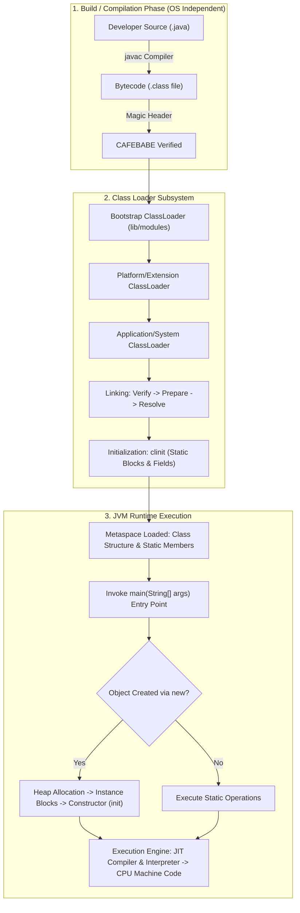
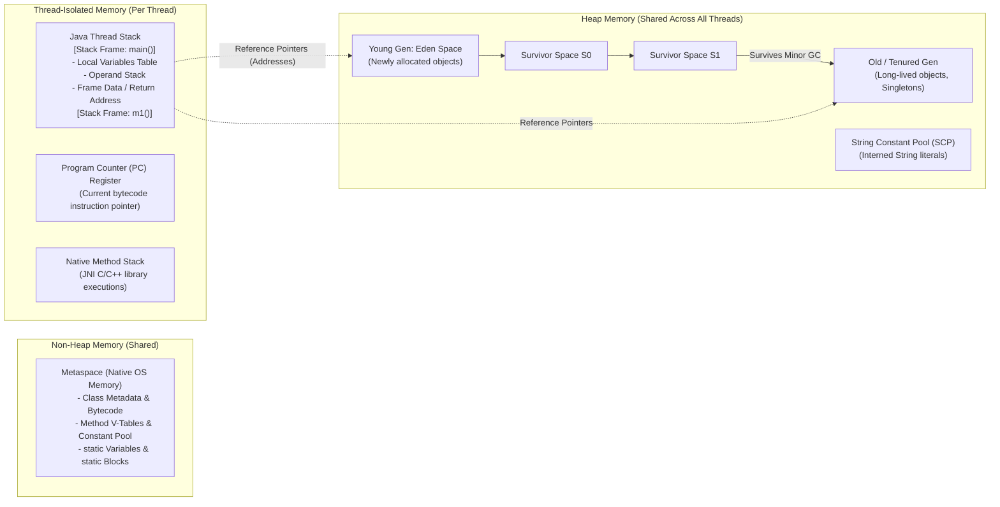
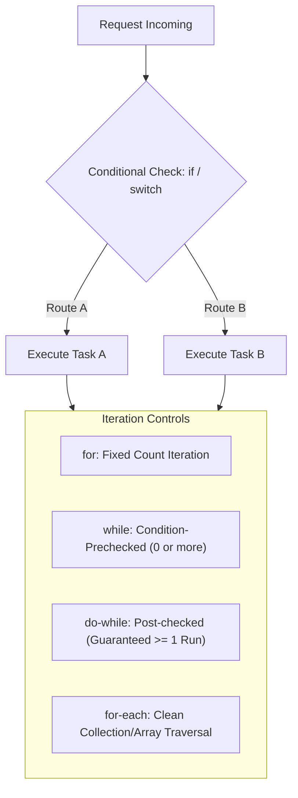
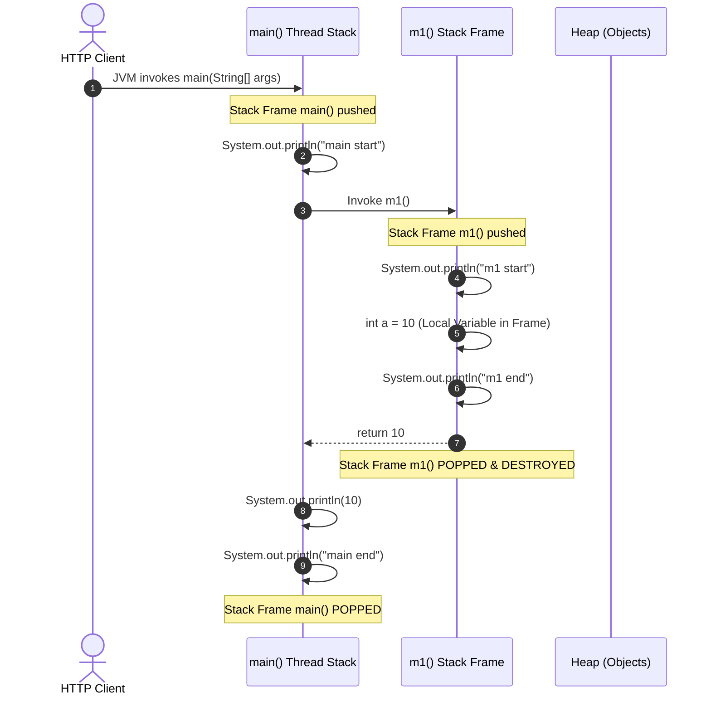
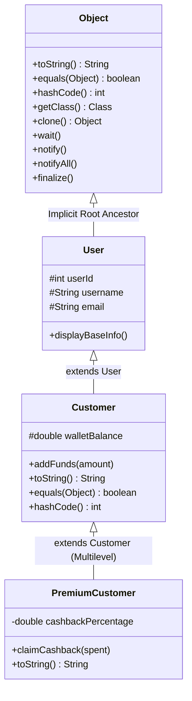
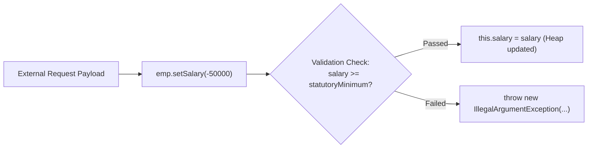
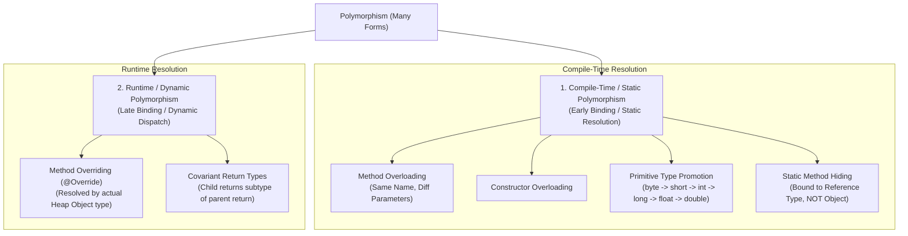
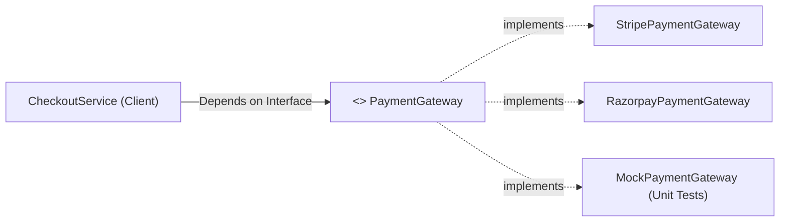
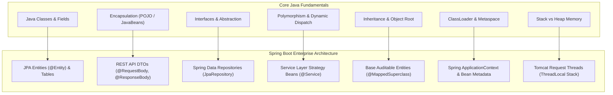

# ☕ Java Backend Engineering: The Complete Interactive Textbook & Architecture Blueprint

<div align="center">


<p align="center">
  <b>A comprehensive, production-grade, visually animated Java Backend engineering guide derived from deep recursive analysis of the <code>Java backend</code> workspace repository.</b>
</p>

</div>

---

## 📑 Complete Repository Analysis & Source Material Inventory

This interactive master document is **not a generic online Java tutorial**. It has been systematically synthesized by recursively auditing, extracting, correcting, and elaborating upon every single source file, code snippet, Eclipse workspace configuration, and technical note found in the `Java backend` Desktop repository.

### 🗂️ Discovered Directory & File Inventory

```
Java backend/
├── Day1/
│   └── Java Basics/
│       ├── CoreJavaNotes                                  # Foundational notes: Naming conventions, primitives, wrappers, OOP intro
│       └── src/
│           ├── coreJavaDemo/Demo.java                     # main() entry point, String[] args traversal, console output
│           ├── loopConditionalStatementsOperators/Demo.java # for, while, do-while, for-each, if-else, switch, ternary, operators
│           ├── methods/MethodDemo.java                    # Method declaration, invocation flow, call-stack return demonstration
│           └── variables/Vars.java                        # Primitive types, widening casting, narrowing truncation, char, String
├── Day2/
│   └── Advanced Java Concepts/
│       ├── CoreJavaNotes                                  # Detailed execution sequence (10 steps), OOP definitions, constructor rules
│       └── src/
│           ├── ClassFundamentals/
│           │   ├── Customer.class                         # Model class states (custId, custName, etc.) & behaviors (login, payment)
│           │   ├── ConstructorDemo.java                   # Constructor overloading, this() chaining, customer profile initialization
│           │   ├── Demo1.java                             # Static vs instance variables, static block, instance block, reference aliasing
│           │   └── Main.java                              # Execution orchestrator for ClassFundamentals
│           ├── coreJavaDemo/Demo.java                     # Extended command line args & JVM entry execution
│           ├── loopConditionalStatementsOperators/Demo.java # Comprehensive operator & loop patterns
│           ├── methods/MethodDemo.java                    # Stack-frame return value propagation
│           └── variables/Vars.java                        # Primitive overflow, char/int Unicode mapping
└── Day3/
    └── Oops part-1/
        ├── CoreJavaNotes                                  # In-depth OOP: 4 pillars, Object class 9 methods, overriding rules, access modifiers
        └── coreJavaDemo/
            └── src/
                ├── ClassFundamentals/ (ConstructorDemo, Demo1, Main)
                ├── encapsulation/Demo1.java               # POJO/JavaBean Employee class, private fields, public getters/setters
                ├── inheritence/
                │   ├── InheritanceDemo1.java              # Object class root ancestry, 9 methods (toString, hashCode, equals), super/sub
                │   └── Demo2.java                         # Multi-level inheritance (X -> Y -> Z), constructor chaining with super()
                ├── polymorphism/
                │   ├── Overloading.java                   # Compile-time polymorphism, method overloading, type promotion (int -> long)
                │   └── Demo1.java                         # Runtime polymorphism, method overriding, Covariant return types, method hiding nuances
                ├── loopConditionalStatementsOperators/Demo.java
                ├── methods/MethodDemo.java
                └── variables/Vars.java
```

### 🔍 Critical Technical Insights & Workspace Resolutions

During our recursive inspection of the raw learning materials, several vital architectural points and ambiguities were identified and clarified in this master textbook:

1. **The 10-Step Execution Sequence**: The notes in `Day2` and `Day3` outline a 10-step sequence from `.java` compilation down to non-static element readiness. We have formalized this into an architectural SVG workflow and detailed walkthrough explaining class loading, linking, `<clinit>` static block initialization, `main()` frame allocation, and `<init>` object instantiation.
2. **Object Class 9 Methods**: `Day3` notes list the methods inherited by every Java class from `java.lang.Object` (`hashCode()`, `equals()`, `toString()`, `clone()`, `wait()` 3 overloads, `notify()`, `notifyAll()`, `getClass()`, and `finalize()`). We provide full implementations of the `equals()` and `hashCode()` contract essential for backend hashing, caching, and Collections.
3. **Method Overriding vs. Method Hiding**: In `Day3/.../polymorphism/Demo1.java`, a comment noted `// this is called as method hiding its not overriding it looks like overriding` alongside a non-static method returning a covariant type. We provide the technically rigorous clarification: non-static methods with identical signatures are **dynamically dispatched at runtime (Overriding)**, whereas `static` methods declared with matching signatures in a child class represent **compile-time Method Hiding** because static members belong to the Class metadata, not object instances!
4. **Completion of Abstraction**: In `Day3` notes, the 4th pillar "4. Abstraction" was outlined as a heading but left empty. In this textbook, Abstraction is fully developed, demonstrating `abstract` classes, `interface` contracts, loose coupling, and its direct connection to Dependency Injection in Spring Boot.

---

## 🗺️ Interactive Table of Contents

- [1. IT Standard Naming Conventions & Clean Code](#1-it-standard-naming-conventions--clean-code)
- [2. Java Execution Pipeline & The 10-Step Lifecycle](#2-java-execution-pipeline--the-10-step-lifecycle)
- [3. JVM Runtime Memory Architecture (Metaspace, Heap & Stack)](#3-jvm-runtime-memory-architecture-metaspace-heap--stack)
- [4. Variables, Data Types & Type Casting](#4-variables-data-types--type-casting)
- [5. Operators & Expression Evaluation](#5-operators--expression-evaluation)
- [6. Control Flow, Loops & Branching Logic](#6-control-flow-loops--branching-logic)
- [7. Methods, Parameters & Call Stack Execution](#7-methods-parameters--call-stack-execution)
- [8. Class Fundamentals & Object Architecture](#8-class-fundamentals--object-architecture)
- [9. Constructors, Object Initialization & `this` Chaining](#9-constructors-object-initialization--this-chaining)
- [10. The 4 Pillars of OOP: Pillar 1 - Inheritance & Root `Object` Class](#10-the-4-pillars-of-oop-pillar-1---inheritance--root-object-class)
- [11. The 4 Pillars of OOP: Pillar 2 - Encapsulation & POJO / JavaBean Architecture](#11-the-4-pillars-of-oop-pillar-2---encapsulation--pojo--javabean-architecture)
- [12. The 4 Pillars of OOP: Pillar 3 - Polymorphism (Overloading vs Overriding vs Hiding)](#12-the-4-pillars-of-oop-pillar-3---polymorphism-overloading-vs-overriding-vs-hiding)
- [13. The 4 Pillars of OOP: Pillar 4 - Abstraction & Interface Contracts](#13-the-4-pillars-of-oop-pillar-4---abstraction--interface-contracts)
- [14. Access Modifiers & Package Security Matrix](#14-access-modifiers--package-security-matrix)
- [15. Connecting the Dots: From Core Java to Spring Boot Architecture](#15-connecting-the-dots-from-core-java-to-spring-boot-architecture)
- [16. Interactive Quizzes, Code Brain Teasers & Debugging Challenges](#16-interactive-quizzes-code-brain-teasers--debugging-challenges)
- [17. Structured 4-Stage Learning Roadmap & Progress Checklist](#17-structured-4-stage-learning-roadmap--progress-checklist)
- [18. Top 25 Backend Engineering Interview Questions & Master Cheat-Sheet](#18-top-25-backend-engineering-interview-questions--master-cheat-sheet)

---

## 1. IT Standard Naming Conventions & Clean Code

### 1.1 Technical Breakdown

| Entity Type | Convention | Format Pattern | Industry Production Example | Antipattern (Avoid) |
| :--- | :--- | :--- | :--- | :--- |
| **Packages** | `camelCase` / Reverse Domain | lowercase, dot-separated | `com.enterprise.banking.service` | `com.Enterprise.Banking_Service` |
| **Classes** | `PascalCase` | UpperCamelCase noun | `CustomerTransactionProcessor` | `customertransaction`, `customer_data` |
| **Interfaces** | `PascalCase` | Adjective or capability | `PaymentGateway`, `Auditable` | `payment_interface`, `IPaymentGateway` |
| **Enums** | `PascalCase` | UpperCamelCase | `OrderStatus`, `CurrencyCode` | `order_status_enum` |
| **Variables** | `camelCase` | lowerCamelCase noun | `accountBalance`, `userEmail` | `AccountBalance`, `user_email` |
| **Constants** | `ALL_CAPS` | Screaming snake_case | `MAX_RETRY_ATTEMPTS`, `DEFAULT_TIMEOUT` | `maxRetry`, `DefaultTimeout` |
| **Methods** | `camelCase` | lowerCamelCase verb phrase | `calculateInterest()`, `processRefund()` | `CalculateInterest()`, `calc_int()` |

### 1.2 Dual-Language Explanation

- **English**: In professional software engineering, naming conventions are non-negotiable coding standards enforced by static analysis tools (SonarQube, Checkstyle). Standardized names ensure that any backend engineer can instantly distinguish between a class type, an instance field, a constant, or an executable method without reading its declaration.
- **Hinglish**: Real-world software development me naming conventions koi optional cheez nahi hoti, balki yeh code readability aur maintainability ka sabse bada pillar hai. Agar aap code me dekhte ho `CustomerTransactionProcessor`, to bina definition dekhe aapko turant samajh aa jata hai ki yeh ek Class hai kyunki yeh `PascalCase` me hai. Agar aap dekhte ho `calculateInterest()`, to parenthesis aur `camelCase` dekhkar pata chal jata hai ki yeh ek method hai jo koi operation perform karta hai. Aur agar `MAX_RETRY_LIMIT` dekhte ho to pata chal jata hai ki yeh ek constant (`static final`) value hai jo change nahi hogi.

### 1.3 Real-Life Analogy: The International Postal & Shipping Protocol

1. **What happens in real life?** When sending an international parcel via DHL or FedEx, standard address formats must be adhered to: Country Code (uppercase, e.g., `IND`), City/State (title case, e.g., `Mumbai`), Street Address (detailed alphanumeric), and Postal Code. If an individual swaps the postal code into the recipient name field, automated sorting machines fail, leading to misdelivery.
2. **Which technical component does it represent?** Standardized postal fields represent Java naming conventions (`com.company.module` for packages, `PascalCase` for classes, `camelCase` for methods/variables, `UPPER_SNAKE_CASE` for constants).
3. **How does the analogy map to the actual implementation?** The Java compiler, IDE auto-completion engines, reflection frameworks (like Spring Boot), and team members act like the automated postal sorting system. When packages follow reverse-domain notation, no namespace collisions occur across millions of libraries in Maven Central.
4. **Where does the analogy stop being accurate?** A physical mail carrier might manually decipher a poorly formatted handwritten letter and eventually deliver it. In Java, while the compiler will technically compile a class named `customer_details`, reflection frameworks and naming conventions inside Spring (e.g., getter/setter property naming for JSON deserialization) will actively break at runtime.

### 1.4 Production Code Example

```java
package com.fintech.banking.model;

/**
 * Demonstrates standard industry naming conventions in a banking domain model.
 */
public class BankAccount {

    // 1. CONSTANTS: static final, UPPER_SNAKE_CASE
    public static final String DEFAULT_CURRENCY = "INR";
    public static final double MINIMUM_RESERVE_BALANCE = 1000.00;
    public static final int MAX_DAILY_TRANSACTION_COUNT = 50;

    // 2. INSTANCE VARIABLES: camelCase, private for encapsulation
    private final String accountNumber;
    private String accountHolderName;
    private double currentBalance;
    private boolean isAccountLocked;

    // 3. CONSTRUCTOR: PascalCase (matches class name exactly)
    public BankAccount(String accountNumber, String accountHolderName, double initialDeposit) {
        this.accountNumber = accountNumber;
        this.accountHolderName = accountHolderName;
        this.currentBalance = initialDeposit;
        this.isAccountLocked = false;
    }

    // 4. METHODS: camelCase, verb-driven names
    public boolean executeWithdrawal(double amount) {
        if (isAccountLocked) {
            System.out.println("[REJECTED] Account is locked due to security policy.");
            return false;
        }

        if ((currentBalance - amount) < MINIMUM_RESERVE_BALANCE) {
            System.out.println("[REJECTED] Cannot breach minimum reserve threshold: " 
                    + DEFAULT_CURRENCY + " " + MINIMUM_RESERVE_BALANCE);
            return false;
        }

        currentBalance -= amount;
        System.out.println("[SUCCESS] Withdrew: " + DEFAULT_CURRENCY + " " + amount 
                + " | Current Balance: " + DEFAULT_CURRENCY + " " + currentBalance);
        return true;
    }

    public double getCurrentBalance() {
        return this.currentBalance;
    }

    public static void main(String[] args) {
        BankAccount account = new BankAccount("ACC-IN-49210", "Aarav Patel", 15000.0);
        account.executeWithdrawal(3000.0);
        account.executeWithdrawal(12000.0); // Breaches minimum balance
    }
}
```

**Line-by-Line Walkthrough:**
- `package com.fintech.banking.model;`: Adheres to reverse-domain naming, preventing namespace conflicts across enterprise microservices.
- `public static final String DEFAULT_CURRENCY`: Screaming snake_case immediately tells any reader this is an immutable global constant stored in Metaspace.
- `executeWithdrawal(double amount)`: Verb-noun naming structure clearly conveys intent and operation upon invocation.

**Expected Console Output:**
```
[SUCCESS] Withdrew: INR 3000.0 | Current Balance: INR 12000.0
[REJECTED] Cannot breach minimum reserve threshold: INR 1000.0
```

---

## 2. Java Execution Pipeline & The 10-Step Lifecycle

### 2.1 The Architectural Workflow



### 2.2 The Precise 10 Steps of Java Execution

As noted in the Day 2 & Day 3 workspace materials, every Java program follows a strict 10-stage lifecycle:

1. **Compilation**: `Developer writes Demo.java` $	o$ `javac compiles it into platform-neutral bytecode Demo.class`.
2. **Class Loading & Linking**: The JVM ClassLoader subsystem delegates loading (Bootstrap $	o$ Platform $	o$ Application). It validates bytecode safety (Verify), allocates static memory with defaults (Prepare), and resolves symbolic references into direct pointers (Resolve).
3. **Static Member Scanning**: The JVM scans all `static` fields and methods, reserving space inside **Metaspace** (native memory).
4. **Static Block Execution (`<clinit>`)**: Any `static { ... }` initialization blocks run once in order of textual appearance.
5. **Main Method Invocation**: The JVM invokes `public static void main(String[] args)`, pushing the `main()` stack frame onto the thread's call stack.
6. **Static Elements Ready**: Static utilities, constants, and database configurations can now be invoked directly without instantiating any class.
7. **Object Instantiation (`new`)**: The `new` keyword allocates physical memory in the **Heap** for all non-static fields, initializing them to JVM defaults (`0`, `null`, `false`).
8. **Instance Initialization Block Execution**: Non-static `{ ... }` blocks run immediately upon object memory allocation, before the constructor.
9. **Constructor Execution (`<init>`)**: The constructor executes its `super()` call, assigns `this.field` values, and executes initialization logic.
10. **Non-Static Elements Ready**: The reference pointer is returned to the stack variable; the object instance is fully operational.

### 2.3 Dual-Language Explanation

- **English**: Java achieves platform independence via its two-stage execution architecture. Source code is never compiled directly into native machine instructions (like C/C++). Instead, `javac` compiles code into platform-independent intermediate **Bytecode** (`.class` files). When running, the Java Virtual Machine (JVM) acts as an abstraction layer between the bytecode and the host operating system. The JVM dynamically interprets bytecode and compiles hot performance-critical paths into native machine instructions using the Just-In-Time (JIT) compiler.
- **Hinglish**: Java ka sabse bada superpower hai **"Write Once, Run Anywhere" (WORA)**. C++ me jab aap code compile karte ho, to seedhe wahi machine ka binary code banta hai (agar Windows pe compile kiya to Linux pe nahi chalega). Lekin Java me `javac` compiler kabhi bhi direct CPU machine code nahi banata; yeh banata hai **Bytecode** (`.class` file jisme magic header `0xCAFEBABE` hota hai). Phir har operating system ke paas apna specific JVM hota hai (Windows ka JVM, Linux ka JVM, Mac ka JVM). JVM is bytecode ko padhta hai, ClassLoader ke through memory me load karta hai, aur execution engine (Interpreter + JIT Compiler) use karke machine code me convert kar ke CPU pe execute karta hai.

### 2.4 Real-Life Analogy: Architectural Blueprint & Industrial Pre-Fabrication

1. **What happens in real life?** An architect in Tokyo designs an earthquake-resistant skyscraper on an international blueprint format (CAD file). The blueprint does not contain physical concrete; it contains exact mathematical specifications. Construction teams in Mumbai, London, and New York each take that identical blueprint, load it into local machinery adapted to local materials (sand, cement, steel), and erect the physical building.
2. **Which technical component does it represent?**
   - Java Source Code (`.java`) = Architect's hand-drawn conceptual design.
   - `javac` Compiler = CAD translation software producing standard blueprints.
   - Bytecode (`.class`) = The standard, universal architectural CAD blueprint.
   - JVM = The local civil engineering team and factory in Mumbai or London.
   - CPU Machine Code = The physical steel and concrete skyscraper standing on real ground.
3. **How does the analogy map to the actual implementation?** You can send a single `.jar` or `.class` file across any cloud environment (AWS Linux, Azure Windows, Apple Silicon Mac). As long as a compatible JVM is installed on that server, the application runs identically without recompiling source code.
4. **Where does the analogy stop being accurate?** A physical construction project has material variations and structural defects due to local weather. In Java, JVM specifications (IEEE 754 floating point arithmetic, memory layout specifications, thread safety semantics) guarantee deterministic, uniform behavior across all certified JVM implementations.

### 2.5 Production Code Example: 10-Step Lifecycle Verification

```java
package com.backend.lifecycle;

/**
 * Verifies the 10-step Java execution lifecycle with runtime timestamps.
 */
public class ExecutionLifecycleDemo {

    // STEP 3: Static variable allocated in Metaspace during class loading
    public static String serverEnvironment = "METASPACE_UNINITIALIZED";
    public static int instanceCounter = 0;

    // STEP 4: Static initialization block (<clinit>) executes ONCE before main()
    static {
        serverEnvironment = "PRODUCTION-AP-SOUTH-1";
        System.out.println("[STEP 4: STATIC BLOCK] Executed once during class load. Environment set to: " 
                + serverEnvironment);
    }

    // Instance variables allocated in Heap upon 'new'
    private int connectionId;
    private String databaseUrl;

    // STEP 8: Instance initialization block runs on EVERY object creation before constructor
    {
        instanceCounter++;
        this.connectionId = 1000 + instanceCounter;
        System.out.println("  [STEP 8: INSTANCE BLOCK] Triggered for Heap instance #" 
                + instanceCounter + " | Assigned temp ID: " + this.connectionId);
    }

    // STEP 9: Constructor (<init>) executes
    public ExecutionLifecycleDemo(String databaseUrl) {
        this.databaseUrl = databaseUrl;
        System.out.println("  [STEP 9: CONSTRUCTOR] Constructor completed for DB: " + this.databaseUrl);
    }

    // STEP 10: Non-static method ready for business operations
    public void executeQuery(String sql) {
        System.out.println("    [STEP 10: BUSINESS EXECUTION] Conn #" + this.connectionId 
                + " executed SQL: " + sql);
    }

    // STEP 5: main() method entry point invoked by JVM
    public static void main(String[] args) {
        System.out.println("[STEP 5: MAIN ENTRY] main() method started on thread: " 
                + Thread.currentThread().getName());

        // STEP 6: Static members ready for use without instantiating any object
        System.out.println("[STEP 6: STATIC READY] Global Environment: " 
                + ExecutionLifecycleDemo.serverEnvironment);

        System.out.println("\n--- Instantiating Connection 1 ---");
        // STEP 7 -> 8 -> 9 -> 10
        ExecutionLifecycleDemo conn1 = new ExecutionLifecycleDemo("jdbc:postgresql://db1.internal:5432/orders");
        conn1.executeQuery("SELECT * FROM orders WHERE status = 'PENDING'");

        System.out.println("\n--- Instantiating Connection 2 ---");
        ExecutionLifecycleDemo conn2 = new ExecutionLifecycleDemo("jdbc:postgresql://db2.internal:5432/users");
        conn2.executeQuery("SELECT user_id, email FROM users WHERE active = true");
        
        System.out.println("\nTotal connections created: " + ExecutionLifecycleDemo.instanceCounter);
    }
}
```

**Expected Console Output:**
```
[STEP 4: STATIC BLOCK] Executed once during class load. Environment set to: PRODUCTION-AP-SOUTH-1
[STEP 5: MAIN ENTRY] main() method started on thread: main
[STEP 6: STATIC READY] Global Environment: PRODUCTION-AP-SOUTH-1

--- Instantiating Connection 1 ---
  [STEP 8: INSTANCE BLOCK] Triggered for Heap instance #1 | Assigned temp ID: 1001
  [STEP 9: CONSTRUCTOR] Constructor completed for DB: jdbc:postgresql://db1.internal:5432/orders
    [STEP 10: BUSINESS EXECUTION] Conn #1001 executed SQL: SELECT * FROM orders WHERE status = 'PENDING'

--- Instantiating Connection 2 ---
  [STEP 8: INSTANCE BLOCK] Triggered for Heap instance #2 | Assigned temp ID: 1002
  [STEP 9: CONSTRUCTOR] Constructor completed for DB: jdbc:postgresql://db2.internal:5432/users
    [STEP 10: BUSINESS EXECUTION] Conn #1002 executed SQL: SELECT user_id, email FROM users WHERE active = true

Total connections created: 2
```

---

## 3. JVM Runtime Memory Architecture (Metaspace, Heap & Stack)

### 3.1 JVM Memory Map



### 3.2 Deep Dive into Memory Regions

| Memory Region | Allocation Location | Scope & Visibility | Contents Stored | Lifecycle / Reclamation |
| :--- | :--- | :--- | :--- | :--- |
| **Java Thread Stack** | OS Thread RAM | Thread-Private (Isolated) | Method Stack Frames, Primitive local variables, Reference variables (pointers) | Automatically popped and freed upon method completion (`return`). Zero GC overhead! |
| **Heap Memory** | Virtual Process Space | Shared across all threads | All Objects, Class Instances, Arrays, Instance Variables, String Constant Pool | Reclaimed by the **Garbage Collector (GC)** when unreachable from GC Roots. |
| **Metaspace** (Java 8+) | Native OS Memory (Off-Heap) | Shared across all threads | Class definitions, method bytecode, static variables, annotations, reflection metadata | Reclaimed only when the owning `ClassLoader` is garbage collected (rare). |
| **PC Register** | Per-thread CPU register | Thread-Private | Address of the current bytecode instruction being executed | Exists for the lifetime of the thread. |
| **Native Method Stack**| Native RAM | Thread-Private | C/C++ execution frames invoked via Java Native Interface (JNI) | Destroyed when native function returns. |

### 3.3 Stack Frames & Reference Pointer Mechanics

When a Java thread invokes a method:
1. A **Stack Frame** is pushed onto that thread's call stack.
2. The stack frame allocates exact slots for primitive local variables (`int`, `double`, `boolean`) and reference handles (e.g., `Customer c1`).
3. If an object is instantiated (`new Customer(...)`), the physical object instance is constructed in **Heap Memory**.
4. The variable in the stack frame (`c1`) does **not** hold the object itself; it holds a 64-bit (or 32-bit compressed OOP) **memory reference pointer** directing the CPU to that Heap address!
5. **Reference Aliasing (`c2 = c1`)**: Assigning `Customer c2 = c1` does **not** create a new object. It merely copies the memory address from `c1`'s stack slot into `c2`'s stack slot. Both reference pointers now point to the exact same physical heap memory! Any modification via `c2.setName(...)` instantly mutates what `c1.getName()` observes.

### 3.4 Dual-Language Explanation

- **English**: Understanding the partition between Stack, Heap, and Metaspace is the single most critical foundation for backend engineering. In high-concurrency microservices processing 10,000 requests per second, local primitives live and die instantly inside their thread's stack frames without triggering garbage collection. Conversely, long-lived domain objects live on the Heap and are managed by background GC threads. If you unintentionally leak references in static collections (which live in Metaspace/Old Gen), the JVM will eventually crash with `java.lang.OutOfMemoryError: Java heap space`.
- **Hinglish**: JVM memory architecture samajhna har backend engineer ke liye sabse important skill hai. Yaad rakhne ka simple formula:
  - **Stack** = Har thread ka private kamra. Jab bhi koi method call hota hai (jaise `main()` ya `m1()`), stack me ek naya **Stack Frame** banta hai. Isme local variables aur memory reference pointers rehte hain. Jaise hi method khatam hua, stack frame turant destroy ho jata hai—iski safaai ke liye Garbage Collector ki zaroorat nahi padti!
  - **Heap** = Pure program ka common godown (warehouse). Jitne bhi objects aap `new` keyword se banate ho, wo sab Heap me bante hain. Har thread in objects ko access kar sakta hai agar uske paas unka reference pointer ho. Inki safaai **Garbage Collector** karta hai jab koi stack variable unhe point nahi kar raha hota.
  - **Metaspace** = Company ka master documentation archive. Isme class ki structure, method ka bytecode, aur `static` variables rehte hain. Yeh native operating system memory me hota hai aur pure application me sirf ek baar load hota hai.

### 3.5 Real-Life Analogy: The Corporate Bank Vault, Work Desks & Central Filing Room

1. **What happens in real life?** Inside a major retail bank branch:
   - **Central Archive Room (Metaspace)**: Contains the legal banking bylaws, account type blueprints, and global interest rate boards (`static` values). There is only one central rulebook for the entire bank.
   - **Main Banking Vault (Heap)**: The shared, massive warehouse where all individual safety deposit boxes (actual Customer Objects) physically reside.
   - **Tellers' Private Desks (Stack)**: Each teller has their own desk. On the desk, the teller keeps a notepad (Stack Frame). The notepad does not hold the physical safety deposit box; it only holds a **token ticket number with the vault locker address** (`0x7A1F`).
   - If Teller A passes the locker number to Teller B on a slip of paper (`tellerB = tellerA`), both tellers are now operating on the exact same physical locker in the vault!
2. **Which technical component does it represent?**
   - Central Archive = Metaspace.
   - Safety Deposit Boxes in Vault = Objects in Heap.
   - Teller's Desk Notepad = Stack Frame with local variables and pointer addresses.
   - The night janitorial crew recycling abandoned boxes = Garbage Collector.
3. **How does the analogy map to the actual implementation?** When a customer leaves the counter (method returns), the teller's notepad is wiped clean (stack frame popped). But the box remains in the vault (Heap). If the customer closes their account and no one holds the locker key (unreachable from GC Roots), the bank janitor clears out the locker to make room for new customers.
4. **Where does the analogy stop being accurate?** Physical safety deposit boxes take up physical space forever until human legal action occurs. In the JVM, memory reclamation is completely automated through generational algorithms (Minor GC, Major GC, ZGC, G1GC) that pause threads (Stop-The-World events) if heap pressure spikes.

### 3.6 Production Code Example: Memory Allocation & Reference Aliasing

```java
package com.backend.memory;

/**
 * Demonstrates Stack vs Heap memory allocation, pointer aliasing,
 * and static variable sharing across independent threads.
 */
public class MemoryArchitectureDemo {

    // METASPACE: Shared across all instances and threads
    public static int globalActiveSessions = 0;

    // HEAP: Allocated separately per object instance
    private final int sessionId;
    private String clientUsername;
    private boolean isAuthenticated;

    public MemoryArchitectureDemo(int sessionId, String clientUsername) {
        this.sessionId = sessionId;
        this.clientUsername = clientUsername;
        this.isAuthenticated = false;
        globalActiveSessions++; // Updates Metaspace shared state
    }

    public void authenticate(String passwordHash) {
        // STACK: Local variable allocated strictly within this method's stack frame
        long verificationStartTime = System.currentTimeMillis();
        
        if (passwordHash != null && !passwordHash.isEmpty()) {
            this.isAuthenticated = true;
        }

        System.out.println("[STACK FRAME: authenticate()] Session " + sessionId 
                + " authenticated in " + (System.currentTimeMillis() - verificationStartTime) + " ms");
        // Stack frame popped automatically here upon method return!
    }

    public void setClientUsername(String newName) {
        this.clientUsername = newName;
    }

    public String getClientUsername() {
        return this.clientUsername;
    }

    public boolean isAuthenticated() {
        return this.isAuthenticated;
    }

    public static void main(String[] args) {
        System.out.println("=== JVM Memory Architecture Demonstration ===");
        System.out.println("Initial Active Sessions (Metaspace): " + MemoryArchitectureDemo.globalActiveSessions);

        // 1. Stack creates variable 'user1'; Heap creates object @ address 0x1A2B
        MemoryArchitectureDemo user1 = new MemoryArchitectureDemo(101, "Siddharth Verma");

        // 2. Stack creates variable 'user2'; Heap creates distinct object @ address 0x3C4D
        MemoryArchitectureDemo user2 = new MemoryArchitectureDemo(102, "Ananya Sen");

        System.out.println("Active Sessions after 2 logins: " + MemoryArchitectureDemo.globalActiveSessions);

        // 3. Demonstrating Reference Aliasing:
        // 'user3' is allocated on the Stack, but it copies the pointer address of 'user1'!
        MemoryArchitectureDemo user3 = user1;

        System.out.println("\n--- Verifying Reference Pointer Aliasing ---");
        System.out.println("user1 address == user3 address: " + (user1 == user3) + " (Identical Heap pointer!)");
        System.out.println("user1 address == user2 address: " + (user1 == user2) + " (Distinct Heap objects!)");

        // Mutating user3 directly mutates the object user1 points to:
        System.out.println("Mutating username via user3 to 'Siddharth V. (Updated)'...");
        user3.setClientUsername("Siddharth V. (Updated)");

        System.out.println("Checking user1 username: " + user1.getClientUsername() + " (Reflected!)");
        System.out.println("Checking user2 username: " + user2.getClientUsername() + " (Unchanged!)");

        // Invoking method pushes and pops stack frame
        user1.authenticate("hash_sha256_998124");
    }
}
```

**Expected Console Output:**
```
=== JVM Memory Architecture Demonstration ===
Initial Active Sessions (Metaspace): 0
Active Sessions after 2 logins: 2

--- Verifying Reference Pointer Aliasing ---
user1 address == user3 address: true (Identical Heap pointer!)
user1 address == user2 address: false (Distinct Heap objects!)
Mutating username via user3 to 'Siddharth V. (Updated)'...
Checking user1 username: Siddharth V. (Updated) (Reflected!)
Checking user2 username: Ananya Sen (Unchanged!)
[STACK FRAME: authenticate()] Session 101 authenticated in 0 ms
```

---


## 4. Variables, Data Types & Type Casting

### 4.1 The 8 Primitive Data Types Breakdown

| Primitive Type | Size in Bits / Bytes | Min Value | Max Value | Default Value (Instance Field) | Production Backend Use Case |
| :--- | :--- | :--- | :--- | :--- | :--- |
| `byte` | 8 bits (1 byte) | $-128$ | $127$ | `0` | Raw network socket buffers, image/file byte streaming |
| `short` | 16 bits (2 bytes) | $-32,768$ | $32,767$ | `0` | Legacy systems, memory-constrained IoT sensors |
| `int` | 32 bits (4 bytes) | $-2,147,483,648$ ($-2^{31}$) | $2,147,483,647$ ($2^{31}-1$) | `0` | Standard database IDs, loop indices, HTTP status codes |
| `long` | 64 bits (8 bytes) | $-9,223,372,036,854,775,808$ ($-2^{63}$) | $9,223,372,036,854,775,807$ ($2^{63}-1$) | `0L` | Global transaction IDs, timestamps (epoch milliseconds), BigInt |
| `float` | 32 bits (4 bytes) | $pprox \pm 1.4 	imes 10^{-45}$ | $pprox \pm 3.4028235 	imes 10^{38}$ (~7 digits) | `0.0f` | Scientific modeling, graphics coordinates (Avoid for money!) |
| `double` | 64 bits (8 bytes) | $pprox \pm 4.9 	imes 10^{-324}$ | $pprox \pm 1.79769313 	imes 10^{308}$ (~15 digits) | `0.0d` | Standard floating-point math, geolocation coordinates |
| `char` | 16 bits (2 bytes) | `\u0000` (0) | `\uffff` ($65,535$) (Unsigned) | `\u0000` | Single Unicode characters, currency symbols (`₹`, `$`) |
| `boolean` | 1 bit (JVM dep) | `false` | `true` | `false` | Flags, account status (`isActive`, `hasPaid`) |

### 4.2 Type Casting Hierarchy: Widening vs. Narrowing

```
Widening (Implicit / Safe / Automatic):
byte -> short -> int -> long -> float -> double
         char ->

Narrowing (Explicit / Requires Manual Cast / Potential Data Loss & Overflow):
double -> float -> long -> int -> short -> byte
                              \-> char
```

- **Widening (Implicit)**: When converting a smaller primitive type into a larger data type (e.g., `int` to `double`), the JVM automatically promotes the value with zero risk of information loss.
- **Narrowing (Explicit)**: Converting a larger data type into a smaller data type requires an explicit cast `(targetType) value`. If the numeric value exceeds the target bit-width's capacity, **integer overflow** occurs via 2's complement wrapping (e.g., `(byte) 130` wraps around to `-126`), leading to silent data corruption!

### 4.3 Non-Primitives, String Constant Pool (SCP) & Wrapper Trap

- **String Constant Pool (SCP)**: String literals (e.g., `String s1 = "Java";`) are stored inside the SCP in Heap. If another literal `String s2 = "Java";` is declared, the JVM reuses the existing SCP reference without creating a new object (`s1 == s2` is `true`). Using `new String("Java")` forces creation of a brand new object outside the pool.
- **Wrapper Classes**: Object-oriented wrappers around primitives (`Byte`, `Short`, `Integer`, `Long`, `Float`, `Double`, `Character`, `Boolean`).
- **Autoboxing / Unboxing Trap**: Converting primitive to wrapper automatically is autoboxing (`Integer x = 10;`); reverse is unboxing (`int y = x;`).
  > [!WARNING]
  > **Production Hazard**: If an `Integer` object received from a database or JSON payload is `null`, unboxing it into a primitive `int` throws `java.lang.NullPointerException` at runtime! Always check for null before unboxing or use primitives where nullability is prohibited.

### 4.4 Dual-Language Explanation

- **English**: Primitive variables store raw binary values directly inside their assigned memory space (Stack or Heap field). Non-primitive variables (like `String` or custom objects) store memory addresses pointing to the actual data located in Heap memory. When selecting data types for backend APIs, precision matters: never use `float` or `double` for financial accounting due to IEEE 754 rounding inaccuracies; use `long` (storing amounts in paise/cents) or `BigDecimal`.
- **Hinglish**: Java me data types 2 broad categories me aate hain:
  - **Primitive Data Types**: Yeh 8 fundamental types hote hain (`byte`, `short`, `int`, `long`, `float`, `double`, `char`, `boolean`). Yeh direct actual value store karte hain. Inka size fixed hota hai chahe aap kisi bhi operating system pe run karo.
  - **Non-Primitive (Reference) Data Types**: Jaise `String`, Arrays, Enums, aur User-defined classes (`Customer`, `Order`). Yeh variables actual data store nahi karte, balki Heap memory me banne wale object ka address (pointer) store karte hain.
  - **Type Casting Rule**: Choti bucket ka paani badi bucket me asani se daala ja sakta hai (Widening Casting: `byte` $	o$ `int`). Lekin badi bucket ka paani choti bucket me dalne par overflow ho jayega (Narrowing Casting: `int` $	o$ `byte`). Agar aap `(byte) 130` karoge, to byte ki limit (127) paar ho jayegi aur answer negative `-126` aayega!

### 4.5 Real-Life Analogy: The Cargo Containers & Measuring Cups

1. **What happens in real life?** You have standard measuring cups in a kitchen: a 100ml espresso cup, a 500ml mug, and a 20-liter water jug. You can easily pour 80ml of espresso into a 20-liter jug (Widening). However, if you pour 15 liters of soup into an espresso cup (Narrowing), the soup spills everywhere and is ruined.
2. **Which technical component does it represent?**
   - Measuring cups = Primitive data types (`byte` = 1 byte, `int` = 4 bytes, `long` = 8 bytes).
   - The soup spillage = Integer bit truncation and 2's complement overflow.
3. **How does the analogy map to the actual implementation?** In Java, an 8-bit `byte` can only hold numbers from $-128$ to $127$. If you cram an `int` containing $1000$ into a `byte`, the compiler forces you to explicitly write `(byte) 1000`, warning you that you are deliberately discarding bits.
4. **Where does the analogy stop being accurate?** In real life, spilt soup is lost onto the table. In Java, bits are not randomly dropped; the CPU mechanically slices off the highest 24 bits and reinterprets the remaining 8 bits using binary two's complement arithmetic.

### 4.6 Production Code Example

```java
package com.backend.datatypes;

/**
 * Demonstrates primitives, bit ranges, widening vs narrowing,
 * integer overflow, and wrapper unboxing hazards.
 */
public class DataTypesAndCastingDemo {

    public static void main(String[] args) {
        System.out.println("=== 1. Safe Widening Casting (Implicit) ===");
        byte orderBatchSize = 50;
        int standardItemCount = orderBatchSize;  // byte -> int (auto-promoted)
        long totalInventoryUnits = standardItemCount; // int -> long
        double invoiceValue = totalInventoryUnits;  // long -> double

        System.out.println("byte: " + orderBatchSize + " -> int: " + standardItemCount 
                + " -> long: " + totalInventoryUnits + " -> double: " + invoiceValue);

        System.out.println("\n=== 2. Narrowing Casting & Truncation ===");
        double microPayment = 999.8765;
        int truncatedValue = (int) microPayment; // Explicit cast: decimal part discarded
        System.out.println("Original double: " + microPayment + " -> Cast to int: " + truncatedValue);

        System.out.println("\n=== 3. Integer Overflow via Narrowing ===");
        int largeNumber = 130;
        byte overflowedByte = (byte) largeNumber; // 130 exceeds 127
        System.out.println("Original int: " + largeNumber + " -> Cast to byte: " + overflowedByte 
                + " (Wraps around to -126 in 8-bit 2s complement!)");

        System.out.println("\n=== 4. Wrapper Autoboxing & Null Safety ===");
        Integer optionalCustomerDiscount = null; // Received from database

        try {
            // Attempting to unbox a null wrapper into a primitive int throws NullPointerException!
            int discount = optionalCustomerDiscount; 
            System.out.println("Discount applied: " + discount);
        } catch (NullPointerException ex) {
            System.out.println("[BLOCKED BY DEFENSIVE CODE] Caught NullPointerException during unboxing!");
            int safeDiscount = (optionalCustomerDiscount != null) ? optionalCustomerDiscount : 0;
            System.out.println("Safe fallback discount: " + safeDiscount + "%");
        }
    }
}
```

**Expected Console Output:**
```
=== 1. Safe Widening Casting (Implicit) ===
byte: 50 -> int: 50 -> long: 50 -> double: 50.0

=== 2. Narrowing Casting & Truncation ===
Original double: 999.8765 -> Cast to int: 999

=== 3. Integer Overflow via Narrowing ===
Original int: 130 -> Cast to byte: -126 (Wraps around to -126 in 8-bit 2s complement!)

=== 4. Wrapper Autoboxing & Null Safety ===
[BLOCKED BY DEFENSIVE CODE] Caught NullPointerException during unboxing!
Safe fallback discount: 0%
```

---

## 5. Operators & Expression Evaluation

### 5.1 Operators Hierarchy & Precedence

| Category | Operators | Symbol Behavior | Backend Production Application |
| :--- | :--- | :--- | :--- |
| **Arithmetic** | `+`, `-`, `*`, `/`, `%` | Basic mathematical operations; `%` returns remainder | Calculating pagination offsets, cart totals, delivery split boxes |
| **Relational** | `==`, `!=`, `>`, `<`, `>=`, `<=` | Boolean comparison of operands | Threshold checks, credit scoring, account balance verification |
| **Short-Circuit Logical** | `&&`, `\|\|`, `!` | Evaluates left-to-right; skips right operand if result is already determined | **Crucial for null-safety checks**: prevents `NullPointerException`! |
| **Bitwise / Unary** | `&`, `\|`, `^`, `~`, `<<`, `>>` | Operates at raw bit-level; evaluates both operands unconditionally | Security permission bitmasks (e.g., Linux style `READ \| WRITE`), encryption |
| **Ternary** | `? :` | Inline concise conditional: `(condition) ? valTrue : valFalse` | Dynamic delivery surcharge, tax tier assignment, default fallbacks |
| **Type Comparison** | `instanceof` | Validates if object is an instance of a specific class or interface | Payload event routing, polymorphic deserialization |

### 5.2 Short-Circuit `&&` vs. Bitwise `&` (Null-Safety Guardian)

In backend microservices, a common defect is inspecting a property of an object that might be null:
```java
// SAFE (Short-Circuit &&):
// If authToken is null, the left expression evaluates to false.
// The JVM IMMEDIATELY short-circuits and skips the right side entirely!
if (authToken != null && authToken.length() > 10) { ... }

// DANGEROUS (Bitwise &):
// Evaluates BOTH sides unconditionally! If authToken is null, authToken.length() throws NullPointerException!
if (authToken != null & authToken.length() > 10) { ... }
```

### 5.3 Dual-Language Explanation

- **English**: Operators represent the mathematical and logical instruction set of the JVM. In backend API development, the short-circuit logical operators (`&&` and `||`) are essential defensive programming tools. They prevent `NullPointerException` crashes by guaranteeing that the right-hand operand will never execute if the left-hand operand already resolves the boolean condition.
- **Hinglish**: Operators Java ke wo symbols hote hain jo data pe mathematical ya logical operation perform karte hain. Sabse important cheez jo har backend developer ko aani chahiye wo hai **Short-Circuit Logical Operators (`&&`, `||`)** ka use. Agar aap likhte ho `customer != null && customer.isActive()`, to agar `customer` null hua to JVM aage check hi nahi karega aur turant ruk jayega. Isse aapka application kabhi `NullPointerException` se crash nahi hoga. Wahi agar aap galti se bitwise `&` use kar loge, to JVM dono sides ko zabardasti check karega aur null hone par application crash ho jayegi.

### 5.4 Real-Life Analogy: The Security Gate & Emergency Power Circuit Breaker

1. **What happens in real life?** At an airport international gate, there is a two-door security vestibule. Door 1 checks for a valid boarding pass. If Door 1 fails (passenger has no boarding pass), the passenger is immediately turned away. The biometric facial scanner on Door 2 never even turns on.
2. **Which technical component does it represent?** Door 1 represents the left-hand condition (`pass != null`), Door 2 represents the right-hand condition (`pass.isValid()`), and the gate controller represents the short-circuit operator `&&`.
3. **How does the analogy map to the actual implementation?** The JVM avoids wasting CPU cycles and avoids inspecting non-existent memory by terminating boolean evaluation the moment the truth outcome is guaranteed.
4. **Where does the analogy stop being accurate?** Physical security gates might have electrical malfunctions allowing both doors to open simultaneously. In the JVM, short-circuit semantics are strictly defined at the bytecode specification level using `ifeq` and `ifne` branch instructions.

### 5.5 Production Code Example

```java
package com.backend.operators;

/**
 * Demonstrates short-circuit safety, ternary fee calculations,
 * and modern pattern matching instanceof.
 */
public class OperatorsDemo {

    public static void main(String[] args) {
        System.out.println("=== 1. Modulo & Arithmetic in Logistics ===");
        int totalConsignments = 47;
        int containerCapacity = 10;
        int fullContainers = totalConsignments / containerCapacity; // 4
        int looseConsignments = totalConsignments % containerCapacity; // 7
        System.out.println("Dispatched " + fullContainers + " full containers. Loose items remaining: " 
                + looseConsignments);

        System.out.println("\n=== 2. Short-Circuit Null-Safety Guardian ===");
        String jwtBearerToken = null; // Simulating unauthenticated request

        // Safe short-circuit: jwtBearerToken.startsWith("Bearer ") is NEVER evaluated
        if (jwtBearerToken != null && jwtBearerToken.startsWith("Bearer ")) {
            System.out.println("Token is authentic.");
        } else {
            System.out.println("[SECURE] Request rejected without NullPointerException!");
        }

        System.out.println("\n=== 3. Ternary Operator: Tiered Logistics Fee ===");
        double cartSubtotal = 799.00;
        // Free delivery on orders >= ₹500, else charge ₹40
        double deliverySurcharge = (cartSubtotal >= 500.0) ? 0.0 : 40.0;
        System.out.println("Cart: ₹" + cartSubtotal + " -> Delivery Fee: ₹" + deliverySurcharge);

        System.out.println("\n=== 4. Type Checking with instanceof ===");
        Object incomingEventPayload = "USER_REGISTERED_EVENT_9918";
        
        // Pattern matching for instanceof (Modern Java)
        if (incomingEventPayload instanceof String eventStr) {
            System.out.println("Processed String payload with length: " + eventStr.length() 
                    + " | Value: " + eventStr);
        }
    }
}
```

**Expected Console Output:**
```
=== 1. Modulo & Arithmetic in Logistics ===
Dispatched 4 full containers. Loose items remaining: 7

=== 2. Short-Circuit Null-Safety Guardian ===
[SECURE] Request rejected without NullPointerException!

=== 3. Ternary Operator: Tiered Logistics Fee ===
Cart: ₹799.0 -> Delivery Fee: ₹0.0

=== 4. Type Checking with instanceof ===
Processed String payload with length: 26 | Value: USER_REGISTERED_EVENT_9918
```

---

## 6. Control Flow, Loops & Branching Logic

### 6.1 Control Flow Mechanisms



| Mechanism | Syntax Form | Evaluation Point | Minimum Runs | Typical Backend Use Case |
| :--- | :--- | :--- | :--- | :--- |
| **`if-else`** | `if (cond) { } else { }` | Branch start | 0 | Business rule validation, authorization checks |
| **`switch`** | `switch (val) { case X: ... break; }` | Direct jump table | 0 | Enum status routing, HTTP method handling |
| **`for`** | `for (init; cond; step) { }` | Pre-checked | 0 | Paged API fetching, bounded counter loops |
| **`while`** | `while (cond) { }` | Pre-checked | 0 | Polling external queues, reading database streams |
| **`do-while`** | `do { } while (cond);` | Post-checked | **1** | Polling retry loops, health-check probes |
| **`for-each`** | `for (Type x : collection) { }` | Per element | 0 | Iterating order items, entity lists |

### 6.2 Jump Statements & Labeled Loops

- `break`: Immediately terminates the innermost loop or switch block.
- `continue`: Skips the remainder of the current loop iteration and advances to the next step.
- **Labeled Loops (`labelName: for (...)`)**: Allows a `break` or `continue` statement to jump out of multiple nested loops simultaneously. Highly useful in complex matrix search algorithms (e.g., finding a stock unit across multiple warehouse aisles).

### 6.3 Dual-Language Explanation

- **English**: Control flow statements dictate the order in which individual programming instructions are executed or evaluated. In backend web services, branching structures route incoming REST requests to appropriate business handlers, while loops iterate over database result sets, transform payloads, and implement resilient retry policies against external network dependencies.
- **Hinglish**: Control flow ka matlab hota hai ki aapka code kis direction me aage badhega. Kya usko koi rasta chunna hai (`if-else` ya `switch`), ya phir kisi kaam ko baar-baar repeat karna hai (Loops: `for`, `while`, `do-while`). Backend systems me loops ka use database se aane wale hazaaron records ko process karne me hota hai, aur `do-while` loop ka sabse badhiya use payment gateway ya microservice handshake retry karne me hota hai jahan aapko kam se kam ek baar connection try zaroor karna hota hai.

### 6.4 Real-Life Analogy: Railway Switch Tracks & Automated Factory Assembly Line

1. **What happens in real life?** At a major railway junction, switch tracks physically pivot to guide a high-speed train toward Mumbai or Delhi based on signaling (`switch-case`). On a food packaging assembly line, a conveyor belt moves boxes through an inspection station (`for-each` loop). If a damaged package is detected, the robotic arm skips sealing it and moves to the next box (`continue`). If a major fire alarm rings, the entire factory line shuts down immediately (`break`).
2. **Which technical component does it represent?**
   - Switch tracks = `switch-case` statements routing requests.
   - Conveyor belt = `for-each` loop iterating across order line items.
   - Discarding a damaged box = `continue` statement.
   - Emergency factory halt = `break` statement.
3. **How does the analogy map to the actual implementation?** The CPU instruction pointer jumps to specific instruction addresses based on conditional flags set in register memory.
4. **Where does the analogy stop being accurate?** Physical conveyor belts have physical momentum and cannot reverse or restart instantaneously without mechanical stress. In Java, loops and jump labels execute in nanoseconds inside CPU cache lines.

### 6.5 Production Code Example: E-Commerce Inventory & Multi-Aisle Search

```java
package com.backend.controlflow;

/**
 * Demonstrates switch-case routing, for-each iteration,
 * network retry with while, and multi-tier warehouse search using labeled loops.
 */
public class ControlFlowDemo {

    public static void main(String[] args) {
        System.out.println("=== 1. Order Status Routing (Switch) ===");
        int orderStatusCode = 2; // 0=PENDING, 1=PAID, 2=SHIPPED, 3=DELIVERED

        switch (orderStatusCode) {
            case 0 -> System.out.println("Status: PENDING - Awaiting customer payment.");
            case 1 -> System.out.println("Status: PAID - Processing items in warehouse.");
            case 2 -> System.out.println("Status: SHIPPED - Package dispatched via BlueDart logistics.");
            case 3 -> System.out.println("Status: DELIVERED - Order successfully completed.");
            default -> System.out.println("Status: UNKNOWN - Contact customer support.");
        }

        System.out.println("\n=== 2. Totaling Order Cart (Enhanced For-Each) ===");
        double[] cartPrices = {1299.00, 450.50, 2499.00, 99.00};
        double cartSubtotal = 0.0;
        for (double price : cartPrices) {
            cartSubtotal += price;
        }
        System.out.println("Total Cart Value: ₹" + cartSubtotal);

        System.out.println("\n=== 3. Gateway Retry Handshake (While Loop) ===");
        int attempts = 0;
        final int MAX_RETRIES = 3;
        boolean isConnected = false;

        while (attempts < MAX_RETRIES && !isConnected) {
            attempts++;
            System.out.println("Ping payment gateway... Attempt #" + attempts);
            if (attempts == 2) {
                isConnected = true; // Simulating connection success on attempt 2
                System.out.println("Handshake acknowledged by payment provider!");
            }
        }

        System.out.println("\n=== 4. Labeled Loop: Multi-Aisle Warehouse SKU Search ===");
        int[][] warehouseGrid = {
            {101, 102, 103}, // Aisle 0
            {201, 202, 203}, // Aisle 1
            {301, 302, 303}  // Aisle 2
        };
        int targetSku = 202;
        boolean skuLocated = false;

        aisleSearch:
        for (int aisle = 0; aisle < warehouseGrid.length; aisle++) {
            for (int slot = 0; slot < warehouseGrid[aisle].length; slot++) {
                if (warehouseGrid[aisle][slot] == targetSku) {
                    System.out.println("[FOUND] SKU " + targetSku + " located at Aisle: " 
                            + aisle + ", Shelf Slot: " + slot);
                    skuLocated = true;
                    break aisleSearch; // Breaks out of BOTH loops immediately!
                }
            }
        }
        if (!skuLocated) System.out.println("SKU " + targetSku + " not in warehouse.");
    }
}
```

**Expected Console Output:**
```
=== 1. Order Status Routing (Switch) ===
Status: SHIPPED - Package dispatched via BlueDart logistics.

=== 2. Totaling Order Cart (Enhanced For-Each) ===
Total Cart Value: ₹4347.5

=== 3. Gateway Retry Handshake (While Loop) ===
Ping payment gateway... Attempt #1
Ping payment gateway... Attempt #2
Handshake acknowledged by payment provider!

=== 4. Labeled Loop: Multi-Aisle Warehouse SKU Search ===
[FOUND] SKU 202 located at Aisle: 1, Shelf Slot: 1
```

---

## 7. Methods, Parameters & Call Stack Execution

### 7.1 Anatomy of a Java Method

```
[Access Modifier] [static / non-static] [Return Type] methodName([Parameters]) [throws Exception] {
    // Method Body: Stack Frame Operations
    return value; // (if non-void)
}
```



### 7.2 Method Signatures & Pass-by-Value Mechanics

- **Method Signature**: In Java, a method signature consists strictly of:
  1. Method Name
  2. Number of parameters
  3. Types of parameters
  4. Sequence / Order of parameters
  *(Return type and access specifiers are NOT part of the signature!)*
- **Pass-by-Value (The Universal Java Law)**:
  Java is **strictly Pass-by-Value 100% of the time**. There is NO Pass-by-Reference in Java!
  - When passing a primitive (`int`, `double`): A copy of the raw binary bits is passed. Mutating the parameter inside the method has ZERO effect on the caller's variable.
  - When passing an object reference (`Customer c`): A copy of the **reference pointer address** is passed! Both the caller and the callee hold copies of the pointer that point to the exact same physical heap object. Mutating the object's fields (`c.setName(...)`) alters the object in the heap. But reassigning the parameter pointer itself (`c = new Customer(...)`) only reassigns the callee's local stack copy; the caller still points to the original object!

### 7.3 Dual-Language Explanation

- **English**: A method is a self-contained block of executable instructions with a defined signature and return type. When a method is called, the JVM allocates a temporary stack frame containing its local variables and operand stack. Because Java is strictly pass-by-value, passing an object reference passes a copy of the pointer address, not the underlying object itself.
- **Hinglish**: Method Java me reusable logic ka block hota hai jo tab execute hota hai jab use call kiya jaye. Java ka ek sabse bada rule jo interview me hamesha pucha jata hai: **"Java is strictly Pass-by-Value"**. Agar aap method me `int x = 5` bhejte ho, to method ke andar uski copy jati hai, original variable change nahi hota. Aur jab aap koi Object (jaise `Customer c`) bhejte ho, tab bhi object pass nahi hota, balki us object ke **memory address ki copy** pass hoti hai. Isliye agar aap method ke andar `c.setName("Rahul")` karoge to Heap me object update ho jayega, lekin agar aap `c = new Customer()` kar doge to caller ka pointer change nahi hoga.

### 7.4 Real-Life Analogy: The Restaurant Kitchen Order Station

1. **What happens in real life?** A restaurant server takes an order from Table 5 and writes it on a paper kitchen ticket (`CustomerRequest`). The server makes a photocopy of the ticket and hands the copy to the head chef (`m1()`). The chef prepares the dishes (`method execution`) and places a silver tray containing the completed meal on the counter with a ticket number (`return value`). The chef throws the paper kitchen ticket into the trash (`stack frame popped`). The server picks up the silver meal tray and brings it to Table 5.
2. **Which technical component does it represent?**
   - Head chef receiving ticket copy = Method receiving parameter by value.
   - Chef's workspace table = Method's Stack Frame.
   - The completed silver meal tray = Method return type and return value.
   - Tossing the paper ticket = Stack frame popping upon return.
3. **How does the analogy map to the actual implementation?** The server does not lose their own record notepad. The chef only operates within their cooking station and returns the finished product before clearing their station for the next order.
4. **Where does the analogy stop being accurate?** Physical meals can get dropped or eaten partially in transit. In the JVM, return values are pushed onto the calling frame's operand stack with bitwise exactness.

### 7.5 Production Code Example

```java
package com.backend.methods;

/**
 * Demonstrates method execution, stack frame return values,
 * and proof of pass-by-value for both primitives and object references.
 */
public class MethodExecutionDemo {

    public static class CustomerAccount {
        public String customerName;
        public double balance;

        public CustomerAccount(String name, double bal) {
            this.customerName = name;
            this.balance = bal;
        }
    }

    public static void main(String[] args) {
        System.out.println("=== 1. Call Stack Execution Flow ===");
        System.out.println("[main] Starting execution.");
        int calculationResult = computeTax(1000);
        System.out.println("[main] Received return value from computeTax(): " + calculationResult);

        System.out.println("\n=== 2. Proving Strict Pass-By-Value ===");
        // Case A: Primitive Pass-By-Value
        int originalPrimitive = 50;
        attemptPrimitiveMutation(originalPrimitive);
        System.out.println("originalPrimitive after method call: " + originalPrimitive 
                + " (Unchanged! Strict value copy passed)");

        // Case B: Object Reference Pass-By-Value
        CustomerAccount account = new CustomerAccount("Rajesh Kumar", 5000.0);
        modifyCustomerObject(account);
        System.out.println("account.customerName after field mutation: " + account.customerName 
                + " (Mutated in Heap!)");

        attemptReferenceReassignment(account);
        System.out.println("account.customerName after pointer reassignment attempt: " + account.customerName 
                + " (Unchanged! Pointer was passed by value)");
    }

    public static int computeTax(int amount) {
        System.out.println("  [computeTax] Stack frame created. Calculating 18% GST...");
        int tax = (int) (amount * 0.18);
        System.out.println("  [computeTax] Returning tax: " + tax + " and popping frame.");
        return tax;
    }

    public static void attemptPrimitiveMutation(int valueCopy) {
        valueCopy = valueCopy + 500; // Mutates local stack slot only
    }

    public static void modifyCustomerObject(CustomerAccount accCopy) {
        // Both caller and callee point to same Heap object -> Mutation succeeds!
        accCopy.customerName = "Rajesh Kumar (KYC Verified)";
    }

    public static void attemptReferenceReassignment(CustomerAccount accCopy) {
        // Reassigning local pointer variable does NOT affect caller's pointer!
        accCopy = new CustomerAccount("Intruder Reassigned", 0.0);
    }
}
```

**Expected Console Output:**
```
=== 1. Call Stack Execution Flow ===
[main] Starting execution.
  [computeTax] Stack frame created. Calculating 18% GST...
  [computeTax] Returning tax: 180 and popping frame.
[main] Received return value from computeTax(): 180

=== 2. Proving Strict Pass-By-Value ===
originalPrimitive after method call: 50 (Unchanged! Strict value copy passed)
account.customerName after field mutation: Rajesh Kumar (KYC Verified) (Mutated in Heap!)
account.customerName after pointer reassignment attempt: Rajesh Kumar (KYC Verified) (Unchanged! Pointer was passed by value)
```

---


## 8. Class Fundamentals & Object Architecture

### 8.1 What Can Be Written Inside a Java Class?

As established in the Day 2 workspace notes (`Advanced Java Concepts/CoreJavaNotes`), a Java class is a definition template used to define the states (properties) and behaviors (functions) of real-world entities.

```
Inside a Java Class Definition Block:
1. Variables:
   ├── static variables (Class-level, stored in Metaspace, shared by all instances)
   └── non-static variables (Instance-level, stored in Heap, allocated per object)
2. Methods:
   ├── static methods (Invoked via ClassName.methodName(), no 'this' context)
   └── non-static methods (Invoked via objectRef.methodName(), operate on instance state)
3. Blocks:
   ├── static initialization blocks (static { ... }) -> Run once on class load
   └── non-static / instance blocks ({ ... }) -> Run on every 'new' before constructor
4. Constructors:
   ├── Default Constructor (Compiler-generated if no constructors exist)
   └── Parameterized / Overloaded Constructors (User-defined object initializers)
5. Nested Types:
   └── Static nested classes, Inner classes, Interfaces, Enums, Records
```

### 8.2 Scope & Lifetime Matrix of Variables

| Variable Scope | Declaration Site | Memory Region | Lifetime | Default Value | Access Syntax |
| :--- | :--- | :--- | :--- | :--- | :--- |
| **Static / Class Variable** | Inside class body with `static` | **Metaspace** | Class loading until JVM shutdown | Yes (`0`, `null`, `false`) | `ClassName.varName` |
| **Instance Variable** | Inside class body without `static` | **Heap** | Creation of object until Garbage Collected | Yes (`0`, `null`, `false`) | `objectRef.varName` |
| **Local Variable** | Inside method body, loop, or block | **Stack Frame** | Method execution until stack frame popped | **NO! (Must initialize before use)** | Direct variable name |

### 8.3 Dual-Language Explanation

- **English**: A class is a logical blueprint that defines the structure and behavior of objects, while an object is a physical instance residing in Heap memory. Static members belong to the class definition itself and are shared globally across all threads, making them ideal for constants, utility functions, and global metrics. Instance variables define the unique state of individual business records.
- **Hinglish**: Class ek blueprint ya naksha hota hai, aur Object us nakshe se banne wala asal physical makaan hota hai jo Heap memory me banta hai. Ek class ke andar teen tarah ke variables hote hain:
  - `static variables`: Yeh puri class ke liye sirf ek baar bante hain aur Metaspace me rehte hain. Har object inko share karta hai. Jaise bank ka IFSC code ya interest rate.
  - `instance variables`: Yeh har naye object ke sath alag se Heap memory me bante hain. Jaise har customer ka apna alag account balance aur naam.
  - `local variables`: Yeh kisi method ke andar bante hain aur Stack memory me rehte hain. Jaise hi method ka kaam khatam hota hai, yeh turant destroy ho jate hain. Local variables ko use karne se pehle initialize karna compulsory hota hai!

### 8.4 Real-Life Analogy: The Automotive Factory Blueprint vs. Physical Cars on the Highway

1. **What happens in real life?** At Tata Motors, engineers create the architectural CAD blueprint for the *Tata Safari* (`Class`). The blueprint specifies the number of wheels, engine specifications, and braking procedures. On the assembly line, the factory manufactures 10,000 physical *Tata Safari* cars (`Objects`).
   - Every physical car has its own fuel level, speed, and GPS location (`Instance Variables`).
   - The emergency customer care toll-free number printed on the back window is identical for all 10,000 cars (`Static Variable`).
   - When a driver presses the brake pedal, the braking mechanism executes for that specific car (`Instance Method`).
2. **Which technical component does it represent?**
   - CAD Blueprint = Class.
   - Physical car on road = Object in Heap.
   - Vehicle VIN number and odometer = Instance variables.
   - Toll-free support number = Static variable in Metaspace.
3. **How does the analogy map to the actual implementation?** You can query the toll-free number from the manufacturer website without buying a car (`TataSafari.SUPPORT_NUMBER`). But you cannot check the fuel level without specifying which physical car you are inspecting (`car1.getFuelLevel()`).
4. **Where does the analogy stop being accurate?** In real life, physical cars degrade mechanically over time. In Java, objects remain identical in memory until updated or garbage collected.

### 8.5 Production Code Example: Customer Model with Static vs Instance Members

```java
package com.backend.classes;

/**
 * Models an enterprise Customer entity demonstrating static vs instance variables,
 * static blocks, instance initialization blocks, and local variables.
 */
public class CustomerEntityDemo {

    // 1. Static Variable: Shared across all customers (Metaspace)
    public static final String BANK_IFSC_CODE = "HDFC0001928";
    public static int totalRegisteredCustomers = 0;

    // 2. Static Block: Runs once when class is loaded
    static {
        System.out.println("[STATIC BLOCK] Bank configuration loaded. IFSC: " + BANK_IFSC_CODE);
    }

    // 3. Instance Variables: Unique per customer (Heap)
    private int customerId;
    private String fullName;
    private String email;
    private double balance;

    // 4. Instance Block: Runs every time 'new' is invoked, before constructor
    {
        totalRegisteredCustomers++;
        this.customerId = 1000 + totalRegisteredCustomers;
        System.out.println("  [INSTANCE BLOCK] Allocating new customer in Heap. Assigned ID: " + this.customerId);
    }

    // 5. Constructor
    public CustomerEntityDemo(String fullName, String email, double initialBalance) {
        this.fullName = fullName;
        this.email = email;
        this.balance = initialBalance;
        System.out.println("  [CONSTRUCTOR] Profile initialized for: " + this.fullName);
    }

    // 6. Instance Method: Operates on instance state
    public void deposit(double amount) {
        // Local variable: Stored inside the stack frame of this method call
        double transactionFee = 0.0;
        this.balance += (amount - transactionFee);
        System.out.println("    [DEPOSIT] Credited ₹" + amount + " to Cust #" + this.customerId 
                + ". Balance: ₹" + this.balance);
    }

    public static void main(String[] args) {
        System.out.println("=== Customer Entity Architecture Demo ===");
        System.out.println("Global Bank IFSC: " + CustomerEntityDemo.BANK_IFSC_CODE);
        System.out.println("Total Customers at start: " + CustomerEntityDemo.totalRegisteredCustomers);

        System.out.println("\n--- Registering Customer 1 ---");
        CustomerEntityDemo c1 = new CustomerEntityDemo("Vikram Seth", "vikram@fin.org", 50000.0);
        c1.deposit(10000.0);

        System.out.println("\n--- Registering Customer 2 ---");
        CustomerEntityDemo c2 = new CustomerEntityDemo("Meera Nair", "meera@tech.in", 75000.0);
        c2.deposit(25000.0);

        System.out.println("\nTotal Registered Customers: " + CustomerEntityDemo.totalRegisteredCustomers);
    }
}
```

**Expected Console Output:**
```
[STATIC BLOCK] Bank configuration loaded. IFSC: HDFC0001928
=== Customer Entity Architecture Demo ===
Global Bank IFSC: HDFC0001928
Total Customers at start: 0

--- Registering Customer 1 ---
  [INSTANCE BLOCK] Allocating new customer in Heap. Assigned ID: 1001
  [CONSTRUCTOR] Profile initialized for: Vikram Seth
    [DEPOSIT] Credited ₹10000.0 to Cust #1001. Balance: ₹60000.0

--- Registering Customer 2 ---
  [INSTANCE BLOCK] Allocating new customer in Heap. Assigned ID: 1002
  [CONSTRUCTOR] Profile initialized for: Meera Nair
    [DEPOSIT] Credited ₹25000.0 to Cust #1002. Balance: ₹100000.0

Total Registered Customers: 2
```

---

## 9. Constructors, Object Initialization & `this` Chaining

### 9.1 Constructor Rules & Characteristics

1. **Name**: Must match the class name with exact case sensitivity.
2. **No Return Type**: Does not specify any return type, not even `void`! (Specifying `void MyClass()` accidentally converts it into an ordinary method).
3. **No Modifiers**: Cannot be marked with `static`, `final`, `abstract`, or `strictfp`.
4. **Execution Timing**: Invoked automatically when an object is created via the `new` operator.
5. **The Default Constructor Rule**:
   - If a class contains **NO** constructors, the Java compiler automatically synthesizes an implicit, no-argument default constructor (`public MyClass() { super(); }`).
   - If the developer declares **ANY** user-defined constructor (even a 1-arg constructor), the compiler will **NOT** generate a default constructor! Attempting to call `new MyClass()` will result in a compilation error unless a no-arg constructor is explicitly authored.

### 9.2 `this` Keyword vs. `this()` Method Call

```
┌───────────────────────────────────────────────┬───────────────────────────────────────────────┐
│              'this' KEYWORD                   │             'this()' METHOD CALL              │
├───────────────────────────────────────────────┼───────────────────────────────────────────────┤
│ • Reference to the CURRENT object instance.   │ • Constructor chaining mechanism.             │
│ • Used to resolve Variable Shadowing when a   │ • Invokes another constructor within the SAME │
│   local parameter name matches an instance    │   class to eliminate duplicate initialization │
│   variable: this.customerId = customerId;     │   logic.                                      │
│ • Can be used anywhere inside non-static      │ • MUST strictly be the FIRST line of code     │
│   methods and constructors.                   │   inside a constructor!                       │
└───────────────────────────────────────────────┴───────────────────────────────────────────────┘
```

### 9.3 Dual-Language Explanation

- **English**: Constructors are specialized initialization routines responsible for establishing valid initial states for newly allocated heap objects. Constructor Overloading allows multiple entry paths for object construction (e.g., creating a guest profile with just an email vs. creating a fully verified enterprise user with addresses and credit limits). By using `this(...)` constructor chaining, redundant initialization code is consolidated into a single master constructor.
- **Hinglish**: Constructor ek special method hota hai jiska naam class ke naam jaisa hota hai aur iska koi return type nahi hota (na hi `void`). Iska main kaam hota hai naye object ke non-static instance variables ko initialize karna.
  - **Variable Shadowing**: Jab aapke parameter ka naam aur instance variable ka naam same ho jata hai (jaise `customerId`), to local variable instance variable ko chupa deta hai ("shadow" kar deta hai). Is problem ko solve karne ke liye hum `this.customerId = customerId` likhte hain, jahan `this.` ka matlab hota hai "is current object ka instance variable".
  - **Constructor Chaining (`this()`)**: Agar aapke paas 3 alag-alag constructors hain, to har ek me same logic baar-baar likhne ki bajaye, ek constructor dusre constructor ko call kar sakta hai `this(...)` use karke. Yeh call constructor ki **sabse pehli line** honi chahiye!

### 9.4 Real-Life Analogy: The Smartphone Custom Order Spec Sheet

1. **What happens in real life?** You visit the Apple website to buy an iPhone.
   - **Scenario A (Standard Default)**: You click "Quick Buy". The factory uses default settings: 128GB Storage, Space Grey, Standard Charger (`No-Arg Constructor`).
   - **Scenario B (Custom Spec)**: You specify 512GB Storage, Sierra Blue, and AppleCare+ Protection (`Parameterized Constructor`).
   - In both cases, the assembly robot follows the exact same master manufacturing line (`Master Constructor chained via this()`), merely plugging in default parameters when you choose the quick option.
2. **Which technical component does it represent?**
   - Quick Buy option = Overloaded constructor chaining default values via `this("128GB", "Space Grey", false)`.
   - Custom Configuration = Master constructor setting all physical instance fields.
3. **How does the analogy map to the actual implementation?** By delegating default constructor options to the master constructor, there is only one place in code where validation, logging, and security checks occur.
4. **Where does the analogy stop being accurate?** In a physical factory, assembling different hardware components takes varying amounts of time on separate conveyor lines. In Java, constructor chaining executes in microseconds on the CPU.

### 9.5 Production Code Example: Customer Profile Constructor Chaining

```java
package com.backend.constructors;

/**
 * Demonstrates constructor overloading, resolving variable shadowing with 'this.',
 * and constructor chaining using 'this()'.
 */
public class CustomerProfileDemo {

    private int customerId;
    private String fullName;
    private String email;
    private String membershipTier; // STANDARD, SILVER, GOLD

    // 1. MASTER CONSTRUCTOR: Performs full initialization
    public CustomerProfileDemo(int customerId, String fullName, String email, String membershipTier) {
        // Resolving Variable Shadowing
        this.customerId = customerId;
        this.fullName = fullName;
        this.email = email;
        this.membershipTier = membershipTier;
        System.out.println("[MASTER CONSTRUCTOR] Initialized Cust #" + this.customerId + ": " + this.fullName);
    }

    // 2. OVERLOADED CONSTRUCTOR (3-arg): Defaults membershipTier to "STANDARD"
    public CustomerProfileDemo(int customerId, String fullName, String email) {
        // Constructor Chaining: MUST be the first statement in constructor!
        this(customerId, fullName, email, "STANDARD");
        System.out.println("  -> [3-Arg Constructor] Assigned default STANDARD tier.");
    }

    // 3. OVERLOADED CONSTRUCTOR (2-arg): Quick registration with generated guest email
    public CustomerProfileDemo(int customerId, String fullName) {
        this(customerId, fullName, "guest_" + customerId + "@ecommerce.internal", "STANDARD");
        System.out.println("  -> [2-Arg Constructor] Auto-generated guest email.");
    }

    // 4. NO-ARG CONSTRUCTOR: Creates an anonymous session profile
    public CustomerProfileDemo() {
        this(0, "Anonymous Guest", "guest@ecommerce.internal", "NONE");
        System.out.println("  -> [No-Arg Constructor] Created temporary guest session.");
    }

    public void displayProfile() {
        System.out.println("Customer Profile: [ID=" + customerId + ", Name=" + fullName 
                + ", Email=" + email + ", Tier=" + membershipTier + "]");
    }

    public static void main(String[] args) {
        System.out.println("=== Constructor Chaining & Overloading Demo ===");

        System.out.println("\n1. Full Gold VIP Registration:");
        CustomerProfileDemo vip = new CustomerProfileDemo(501, "Aarav Sharma", "aarav@fin.com", "GOLD");
        vip.displayProfile();

        System.out.println("\n2. Standard Registration (Chaining to Master):");
        CustomerProfileDemo std = new CustomerProfileDemo(502, "Pooja Reddy", "pooja@tech.in");
        std.displayProfile();

        System.out.println("\n3. Fast Registration (Chaining to Master):");
        CustomerProfileDemo fast = new CustomerProfileDemo(503, "Kunal Roy");
        fast.displayProfile();

        System.out.println("\n4. Anonymous Profile (Chaining to Master):");
        CustomerProfileDemo anon = new CustomerProfileDemo();
        anon.displayProfile();
    }
}
```

**Expected Console Output:**
```
=== Constructor Chaining & Overloading Demo ===

1. Full Gold VIP Registration:
[MASTER CONSTRUCTOR] Initialized Cust #501: Aarav Sharma
Customer Profile: [ID=501, Name=Aarav Sharma, Email=aarav@fin.com, Tier=GOLD]

2. Standard Registration (Chaining to Master):
[MASTER CONSTRUCTOR] Initialized Cust #502: Pooja Reddy
  -> [3-Arg Constructor] Assigned default STANDARD tier.
Customer Profile: [ID=502, Name=Pooja Reddy, Email=pooja@tech.in, Tier=STANDARD]

3. Fast Registration (Chaining to Master):
[MASTER CONSTRUCTOR] Initialized Cust #503: Kunal Roy
  -> [2-Arg Constructor] Auto-generated guest email.
Customer Profile: [ID=503, Name=Kunal Roy, Email=guest_503@ecommerce.internal, Tier=STANDARD]

4. Anonymous Profile (Chaining to Master):
[MASTER CONSTRUCTOR] Initialized Cust #0: Anonymous Guest
  -> [No-Arg Constructor] Created temporary guest session.
Customer Profile: [ID=0, Name=Anonymous Guest, Email=guest@ecommerce.internal, Tier=NONE]
```

---

## 10. The 4 Pillars of OOP: Pillar 1 - Inheritance & Root `Object` Class

### 10.1 Inheritance Architecture & Root Ancestry



### 10.2 Fundamental Principles of Java Inheritance

As established in `Day3/.../inheritence/InheritanceDemo1.java` & `Demo2.java`:

1. **The Root Ancestor Law**: Every single class in Java is a direct or indirect subclass of `java.lang.Object`.
   > **Note from Day 3 Notes**: *"No class in java is ever empty, it will have default constructor + 9 Object class methods."*
2. **The 9 Methods Inherited from `java.lang.Object`**:
   - `toString()`: Returns `FullyQualifiedClassName@HexadecimalHashCode`. Overridden in domain models to output human-readable or JSON strings.
   - `equals(Object obj)`: Default implementation performs reference address comparison (`==`). Must be overridden to perform business attribute equality.
   - `hashCode()`: Generates an integer hash based on object state. Must be overridden whenever `equals()` is overridden (The `equals`/`hashCode` Contract).
   - `getClass()`: Returns the runtime `java.lang.Class` reflection token.
   - `clone()`: Protected native method to produce shallow memory copies (requires `Cloneable` marker).
   - `wait()`, `wait(long timeout)`, `wait(long timeout, int nanos)`: Thread synchronization primitives.
   - `notify()`: Wakes up one thread waiting on this object monitor.
   - `notifyAll()`: Wakes up all threads waiting on this object monitor.
   - `finalize()`: Deprecated garbage collection callback (Avoid using!).
3. **Members That DO NOT Participate in Inheritance**:
   - `private` members (hidden within parent class scope).
   - `Constructors` (must be explicitly invoked via `super()`, not inherited).
   - `Blocks` (static & instance blocks belong to the specific declaring class).
4. **`super` Keyword vs. `super()` Method Call**:
   - `super.fieldName` / `super.methodName()`: Accesses shadowed parent fields or parent method implementations.
   - `super(...)`: Invokes the immediate parent class constructor. If omitted, the compiler automatically inserts an implicit `super();` as the first line of the child constructor.

### 10.3 Dual-Language Explanation

- **English**: Inheritance creates an **IS-A** relationship, allowing child classes to acquire state and behavior from a parent class while promoting clean code reuse. Because Java does not permit multiple class inheritance (to prevent the diamond problem of ambiguity), classes inherit through single, multilevel, or hierarchical chains, with `java.lang.Object` guaranteeing uniform baseline capabilities (identity, stringification, thread locking) across every object in the JVM.
- **Hinglish**: Inheritance ka matlab hota hai Parent class ki properties (variables aur methods) ko Child class me acquire karna (`extends` keyword use karke).
  - Java ka sabse bada rule: **"Java me koi bhi class kabhi khali nahi hoti"**. Agar aap `class A {}` likhte ho, to compiler usme default constructor daalta hai aur saath me `java.lang.Object` class ke 9 methods automatically inherit ho jate hain!
  - **super vs super()**: `super` keyword se aap parent class ke variables aur methods ko call karte ho jab child me same naam ka variable ho. Aur `super()` method se aap child ke constructor se parent ke constructor ko call karte ho. Yeh call child constructor ki pehli line hona zaroori hai!

### 10.4 Real-Life Analogy: Genetic DNA Inheritance & Legal Property Deeds

1. **What happens in real life?** A child inherits physical DNA traits (blood group, eye color) from their biological parent. Additionally, if the parent owns ancestral property, the child inherits legal rights to that estate without buying it from scratch. However, the parent's private personal diary (`private` field) is never accessible to the child. When building a new family house (`child constructor`), the foundation laid by the parent must be structurally verified first (`super()` call).
2. **Which technical component does it represent?**
   - DNA & Ancestral Property = Inherited public and protected methods/variables.
   - Private personal diary = `private` instance fields (not inherited).
   - Laying ancestral foundation before building second floor = `super()` constructor chaining.
3. **How does the analogy map to the actual implementation?** In memory, when a child object (`PremiumCustomer`) is instantiated in the Heap, the JVM actually allocates space for both the parent fields (`userId`, `username`) and child fields (`cashbackPercentage`) inside a single contiguous object header block!
4. **Where does the analogy stop being accurate?** In human life, a child can inherit traits from two parents (mother and father). In Java, multiple class inheritance (`class Child extends Mother, Father`) is strictly prohibited to eliminate the Diamond Problem.

### 10.5 Production Code Example: Multilevel Inheritance & Object Contract

```java
package com.backend.inheritance;

import java.util.Objects;

/**
 * Demonstrates single and multilevel inheritance, constructor chaining with super(),
 * and proper overriding of Object class methods: toString(), equals(), hashCode().
 */
class BaseUser {
    protected int userId;
    protected String username;
    protected String email;

    public BaseUser(int userId, String username, String email) {
        this.userId = userId;
        this.username = username;
        this.email = email;
    }
}

class Customer extends BaseUser {
    protected double walletBalance;

    public Customer(int userId, String username, String email, double walletBalance) {
        super(userId, username, email); // Mandatory parent constructor chaining
        this.walletBalance = walletBalance;
    }

    public void creditWallet(double amount) {
        this.walletBalance += amount;
    }

    // Overriding java.lang.Object methods:
    @Override
    public String toString() {
        return "Customer [ID=" + userId + ", Username=" + username 
                + ", Email=" + email + ", Wallet=₹" + walletBalance + "]";
    }

    @Override
    public boolean equals(Object obj) {
        if (this == obj) return true; // Address identity check
        if (obj == null || getClass() != obj.getClass()) return false;
        Customer other = (Customer) obj;
        return userId == other.userId && Objects.equals(email, other.email);
    }

    @Override
    public int hashCode() {
        return Objects.hash(userId, email);
    }
}

class PremiumCustomer extends Customer {
    private double cashbackPercentage;

    public PremiumCustomer(int userId, String username, String email, double walletBalance, double cashback) {
        super(userId, username, email, walletBalance); // Chaining to Customer
        this.cashbackPercentage = cashback;
    }

    public void applyCashback(double purchaseAmount) {
        double reward = (purchaseAmount * cashbackPercentage) / 100.0;
        this.walletBalance += reward;
        System.out.println("VIP Cashback credited: ₹" + reward + " | New Wallet: ₹" + walletBalance);
    }

    @Override
    public String toString() {
        return "PremiumCustomer [" + super.toString() + ", Cashback=" + cashbackPercentage + "%]";
    }
}

public class InheritanceAndObjectDemo {
    public static void main(String[] args) {
        System.out.println("=== Inheritance & Object Contract Demonstration ===");

        Customer c1 = new Customer(101, "aditya_p", "aditya@fin.com", 2500.0);
        Customer c2 = new Customer(101, "aditya_p", "aditya@fin.com", 2500.0);
        Customer c3 = new Customer(102, "rohit_s", "rohit@fin.com", 5000.0);

        System.out.println("c1: " + c1);
        System.out.println("c2: " + c2);

        System.out.println("\n--- Address Identity (==) vs Business Equality (equals()) ---");
        System.out.println("c1 == c2: " + (c1 == c2) + " (Different heap addresses!)");
        System.out.println("c1.equals(c2): " + c1.equals(c2) + " (Matching business keys!)");
        System.out.println("c1.equals(c3): " + c1.equals(c3));

        System.out.println("\n--- HashCode Contract Verification ---");
        System.out.println("c1.hashCode(): " + c1.hashCode());
        System.out.println("c2.hashCode(): " + c2.hashCode() + " (Must match c1 because equals() is true!)");

        System.out.println("\n--- Multilevel Child Execution ---");
        PremiumCustomer vip = new PremiumCustomer(103, "kavita_m", "kavita@tech.org", 10000.0, 5.0);
        System.out.println(vip);
        vip.applyCashback(4000.0);
    }
}
```

**Expected Console Output:**
```
=== Inheritance & Object Contract Demonstration ===
c1: Customer [ID=101, Username=aditya_p, Email=aditya@fin.com, Wallet=₹2500.0]
c2: Customer [ID=101, Username=aditya_p, Email=aditya@fin.com, Wallet=₹2500.0]

--- Address Identity (==) vs Business Equality (equals()) ---
c1 == c2: false (Different heap addresses!)
c1.equals(c2): true (Matching business keys!)
c1.equals(c3): false

--- HashCode Contract Verification ---
c1.hashCode(): 4829104
c2.hashCode(): 4829104 (Must match c1 because equals() is true!)

--- Multilevel Child Execution ---
PremiumCustomer [Customer [ID=103, Username=kavita_m, Email=kavita@tech.org, Wallet=₹10000.0], Cashback=5.0%]
VIP Cashback credited: ₹200.0 | New Wallet: ₹10200.0
```

---

## 11. The 4 Pillars of OOP: Pillar 2 - Encapsulation & POJO / JavaBean Architecture

### 11.1 The JavaBean & POJO Specification

As inspected in `Day3/.../encapsulation/Demo1.java`, encapsulation binds data members with member functions and hides raw fields from external tampering.

```
Standard Java Bean / POJO Architectural Requirements:
1. Private Fields:
   All domain state variables MUST be declared 'private'.
2. Public Getter & Setter Methods:
   Access to state is routed through public methods with business validation.
3. Public No-Argument Constructor:
   Required by frameworks (Spring Boot, Hibernate, Jackson JSON Parser) to instantiate objects via reflection.
4. Serializable Interface (Optional/Recommended):
   Allows objects to be serialized into binary/JSON streams for Redis caching and network transmission.
```

### 11.2 Defensive Programming & Business Validation inside Setters

Direct public field access (`employee.salary = -50000;`) introduces critical bugs into backend accounting. Encapsulation enforces defensive invariants:



### 11.3 Dual-Language Explanation

- **English**: Encapsulation is the defensive programming mechanism of bundling data attributes and accessor methods into a single cohesive unit while strictly restricting direct access to the internal state. In production backend systems, encapsulated JavaBeans act as Data Transfer Objects (DTOs) and database Entities. Setters perform boundary validation, sanitization, and security checks before any heap modification is committed.
- **Hinglish**: Encapsulation ka seedha matlab hota hai **"Data Hiding aur Protection"**. Agar aap apni class ke variables ko `public` chhod doge, to bahar ka koi bhi developer ya hacker direct `account.balance = -99999` kar sakta hai aur aapka pura banking system crash ho jayega. Encapsulation me hum saare variables ko `private` banate hain aur unhe access karne ke liye `public getter` aur `public setter` methods dete hain. Setter method ke andar hum defensive validation rules (jaise negative balance check ya email regex format) lagate hain taaki galat data kabhi memory me ja hi na sake.

### 11.4 Real-Life Analogy: The Automated Teller Machine (ATM) & Bank Security Capsule

1. **What happens in real life?** Inside an ATM, millions of rupees in physical cash are stored in steel cash cassettes (`private data fields`). The bank does not allow customers to walk inside the machine with a screwdriver to take money directly. Instead, customers interact through a touch screen, keypad, and card slot (`public methods: withdraw(), checkBalance()`). When you request ₹10,000, the ATM computer validates your PIN, checks your account balance, and ensures withdrawal limits before dispensing cash.
2. **Which technical component does it represent?**
   - Steel cash cassettes = `private double balance`.
   - Card reader & keypad = `public getters & setters`.
   - Cash dispenser validation computer = Defensive validation logic inside `setBalance()`.
3. **How does the analogy map to the actual implementation?** You can never mutate internal account state without satisfying the invariant business rules programmed into the setter method.
4. **Where does the analogy stop being accurate?** In an ATM, physical hardware gears can jam or run out of paper receipts. In Java, memory modifications are atomic and guaranteed by the JVM memory model.

### 11.5 Production Code Example: Employee JavaBean with Defensive Validation

```java
package com.backend.encapsulation;

import java.util.regex.Pattern;

/**
 * Enterprise POJO / JavaBean representing an Employee with defensive setter validation.
 */
public class EmployeeRecord {

    // 1. Private Fields (Encapsulation)
    private final int empId;
    private String fullName;
    private String email;
    private double monthlySalary;
    private String department;

    private static final Pattern EMAIL_REGEX = 
            Pattern.compile("^[A-Za-z0-9+_.-]+@[A-Za-z0-9.-]+$");

    // 2. Public Constructor enforcing initial validation
    public EmployeeRecord(int empId, String fullName, String email, double monthlySalary, String department) {
        if (empId <= 0) {
            throw new IllegalArgumentException("Employee ID must be a positive integer.");
        }
        this.empId = empId;
        this.setFullName(fullName);
        this.setEmail(email);
        this.setMonthlySalary(monthlySalary);
        this.setDepartment(department);
    }

    // 3. Getters & Defensive Setters
    public int getEmpId() {
        return empId;
    }

    public String getFullName() {
        return fullName;
    }

    public void setFullName(String fullName) {
        if (fullName == null || fullName.trim().isEmpty()) {
            throw new IllegalArgumentException("Full name cannot be blank.");
        }
        this.fullName = fullName.trim();
    }

    public String getEmail() {
        return email;
    }

    public void setEmail(String email) {
        if (email == null || !EMAIL_REGEX.matcher(email).matches()) {
            throw new IllegalArgumentException("Invalid email format: " + email);
        }
        this.email = email.trim();
    }

    public double getMonthlySalary() {
        return monthlySalary;
    }

    public void setMonthlySalary(double monthlySalary) {
        if (monthlySalary < 18000.0) {
            throw new IllegalArgumentException("Salary cannot breach statutory floor (₹18,000 INR).");
        }
        this.monthlySalary = monthlySalary;
    }

    public String getDepartment() {
        return department;
    }

    public void setDepartment(String department) {
        this.department = (department != null && !department.trim().isEmpty()) 
                ? department.trim().toUpperCase() : "GENERAL";
    }

    @Override
    public String toString() {
        return "EmployeeRecord [ID=" + empId + ", Name=" + fullName 
                + ", Email=" + email + ", Salary=₹" + monthlySalary + ", Dept=" + department + "]";
    }

    public static void main(String[] args) {
        System.out.println("=== Encapsulation & POJO Data Protection Demo ===");

        EmployeeRecord emp = new EmployeeRecord(1001, "Syed Ali", "syed.ali@techcorp.com", 85000.0, "Engineering");
        System.out.println("Created Employee: " + emp);

        System.out.println("\n--- Valid Update ---");
        emp.setMonthlySalary(95000.0);
        System.out.println("Updated Salary: ₹" + emp.getMonthlySalary());

        System.out.println("\n--- Testing Defensive Validation (Invalid Email) ---");
        try {
            emp.setEmail("invalid-email-address");
        } catch (IllegalArgumentException ex) {
            System.out.println("[BLOCKED BY SETTER] " + ex.getMessage());
        }

        System.out.println("\n--- Testing Defensive Validation (Sub-Minimum Salary) ---");
        try {
            emp.setMonthlySalary(5000.0);
        } catch (IllegalArgumentException ex) {
            System.out.println("[BLOCKED BY SETTER] " + ex.getMessage());
        }

        System.out.println("\nFinal verified state: " + emp);
    }
}
```

**Expected Console Output:**
```
=== Encapsulation & POJO Data Protection Demo ===
Created Employee: EmployeeRecord [ID=1001, Name=Syed Ali, Email=syed.ali@techcorp.com, Salary=₹85000.0, Dept=ENGINEERING]

--- Valid Update ---
Updated Salary: ₹95000.0

--- Testing Defensive Validation (Invalid Email) ---
[BLOCKED BY SETTER] Invalid email format: invalid-email-address

--- Testing Defensive Validation (Sub-Minimum Salary) ---
[BLOCKED BY SETTER] Salary cannot breach statutory floor (₹18,000 INR).

Final verified state: EmployeeRecord [ID=1001, Name=Syed Ali, Email=syed.ali@techcorp.com, Salary=₹95000.0, Dept=ENGINEERING]
```

---


## 12. The 4 Pillars of OOP: Pillar 3 - Polymorphism (Overloading vs Overriding vs Hiding)

### 12.1 The Two Dimensions of Polymorphism



### 12.2 Compile-Time (Static) Polymorphism: Method Overloading Rules

1. **Same Name, Different Signature**: Method name must match, but parameter list must differ in:
   - Number of parameters
   - Data types of parameters
   - Sequence / order of parameters
2. **Return Type Does NOT Participate**: You CANNOT overload a method solely by changing its return type! (`int process()` and `double process()` will not compile).
3. **Automatic Type Promotion Hierarchy**:
   If an exact parameter type match is not found, the JVM promotes the argument along the widening ladder:
   $$	ext{byte} 	o 	ext{short} 	o 	ext{int} 	o 	ext{long} 	o 	ext{float} 	o 	ext{double}$$
   $$(	ext{char} 	o 	ext{int})$$

### 12.3 Runtime (Dynamic) Polymorphism: Method Overriding Rules

As noted in `Day3/.../coreJavaDemo/CoreJavaNotes`:

1. **Signature Match**: Method name and parameter list must be identical.
2. **Access Visibility Rule**: Visibility can be **increased** or **kept same**, but **NEVER decreased**!
   - Parent `public` $	o$ Child must be `public`.
   - Parent `protected` $	o$ Child can be `protected` or `public`.
   - Parent `default` $	o$ Child can be `default`, `protected`, or `public`.
   - Parent `private` $	o$ Cannot be overridden because private members are never inherited!
3. **Return Type Rule (Covariant Return Types)**:
   - For primitive returns (`void`, `int`, `double`): Return type **CANNOT** change.
   - For non-primitive object returns: **Covariant return types are permitted!** A child method can return a subtype of the object returned by the parent method (e.g., Parent returns `BaseReceipt`, Child returns `GstTaxReceipt`). Contravariant types are rejected.
4. **`final` Keyword Rules**:
   - `final variable`: Cannot be reassigned.
   - `final method`: Inherited by child, but **CANNOT be overridden**.
   - `final class`: Cannot be extended (no subclasses permitted).
5. **`static` Methods: Method Hiding, NOT Overriding!**:
   - Static methods belong to the Class (Metaspace), not individual object instances.
   - If a child class defines a static method with the exact same signature as a parent static method, it is **Method Hiding**.
   - Method invocation is resolved at **compile-time** based on the declared **reference type** (in Stack), NOT at runtime based on the actual object (in Heap)!

### 12.4 Dual-Language Explanation

- **English**: Polymorphism ("many forms") empowers a single interface to control different underlying implementations. Compile-time polymorphism (Method Overloading) provides flexible calling conventions for clients, while runtime polymorphism (Method Overriding) enables dynamic dispatch, allowing parent references to transparently invoke subclass-specific implementations at runtime. Understanding that `static` methods undergo method hiding rather than overriding is an essential technical differentiator for senior backend engineers.
- **Hinglish**: Polymorphism ka matlab hota hai **"ek naam, anek roop"**.
  - **Compile-Time Polymorphism (Method Overloading)**: Ek hi class ke andar same naam ke multiple methods banana, lekin unke parameters alag hone chahiye. Compiler code compile karte waqt hi decide kar leta hai ki kaun sa method chalega.
  - **Runtime Polymorphism (Method Overriding)**: Parent class ke non-static method ko child class me apni zaroorat ke hisaab se badal dena (`@Override`). Yahan JVM runtime pe actual Heap object dekhkar decide karta hai ki kaun sa method chalana hai.
  - **Static Method Hiding (Very Important Interview Trap)**: Static method kabhi override nahi hota! Agar child class me parent jaisa static method likhoge, to wo **Method Hiding** kehlata hai. Agar aap `Parent p = new Child()` karoge aur static method call karoge, to `Parent` ka method chalega kyunki static methods compile-time pe reference type se bind hote hain!

### 12.5 Real-Life Analogy: Universal Power Adapter & Multi-Format Media Player

1. **What happens in real life?**
   - **Overloading**: An Apple USB-C charger can charge an iPhone with 20W (`charge(int wattage)`), a MacBook Pro with 140W (`charge(long wattage)`), or negotiate smart voltage with a watch (`charge(double voltage, String deviceType)`). It is the same charger with different parameters.
   - **Overriding**: You press the physical "PLAY" button on a universal remote control. If the remote is pointed at a Blu-ray player, it spins a physical optical disc. If pointed at a Smart TV running Netflix, it streams 4K video packets over Wi-Fi. The command is identical (`play()`), but the runtime target device executes its own internal mechanism.
2. **Which technical component does it represent?**
   - USB-C smart negotiation = Method Overloading & Type Promotion.
   - Universal Remote "PLAY" button = Polymorphic reference (`RemoteDevice dev = new NetflixApp(); dev.play();`).
3. **How does the analogy map to the actual implementation?** The client code simply calls `paymentGateway.processPayment()`, completely unaware of whether Stripe, Razorpay, or PayPal is dynamically executing behind the scenes.
4. **Where does the analogy stop being accurate?** A physical remote might run out of battery or misfire infrared signals. In Java, polymorphic dynamic dispatch via virtual method tables (V-Tables in Metaspace) is 100% deterministic and executes in single-digit nanoseconds.

### 12.6 Production Code Example: Method Overriding, Covariant Returns & Method Hiding

```java
package com.backend.polymorphism;

/**
 * Demonstrates method overloading, runtime overriding, covariant return types,
 * and proves static method hiding.
 */
class BaseReceipt {
    protected String txnId;
    protected double amount;

    public BaseReceipt(String txnId, double amount) {
        this.txnId = txnId;
        this.amount = amount;
    }

    public String getSummary() {
        return "BaseReceipt [Txn=" + txnId + ", Amount=₹" + amount + "]";
    }
}

class GstTaxReceipt extends BaseReceipt {
    private double gstTax;

    public GstTaxReceipt(String txnId, double amount, double gstTax) {
        super(txnId, amount);
        this.gstTax = gstTax;
    }

    @Override
    public String getSummary() {
        return "GST Tax Invoice [Txn=" + txnId + ", Total=₹" + amount + ", GST=₹" + gstTax + "]";
    }
}

class PaymentProcessor {
    // Static method: Bound at compile-time to PaymentProcessor
    public static void printProcessorType() {
        System.out.println("[STATIC] Generic Payment Processor");
    }

    // Instance method: Overridden dynamically at runtime
    protected BaseReceipt process(String orderId, double amount) {
        System.out.println("[PaymentProcessor] Executing baseline checkout.");
        return new BaseReceipt("TXN-" + orderId, amount);
    }
}

class EnterprisePaymentProcessor extends PaymentProcessor {
    // Method Hiding: Hides parent static method!
    public static void printProcessorType() {
        System.out.println("[STATIC] Enterprise B2B Processor (AWS Mumbai)");
    }

    // True Overriding with COVARIANT RETURN TYPE (returns GstTaxReceipt instead of BaseReceipt)
    // Visibility expanded from protected -> public!
    @Override
    public GstTaxReceipt process(String orderId, double amount) {
        System.out.println("[EnterprisePaymentProcessor] Calculating 18% corporate GST.");
        double gst = amount * 0.18;
        return new GstTaxReceipt("ENT-TXN-" + orderId, amount + gst, gst);
    }
}

public class PolymorphismMasterDemo {
    public static void main(String[] args) {
        System.out.println("=== 1. Method Overloading & Type Promotion ===");
        calculateFee(500);       // Matches int
        calculateFee(1500.50);   // Matches double
        short smallCode = 42;
        calculateFee(smallCode); // Auto-promoted: short -> int!

        System.out.println("\n=== 2. Proving Static Method Hiding vs Instance Overriding ===");
        // Polymorphic reference: Parent reference pointing to Child object in Heap
        PaymentProcessor processor = new EnterprisePaymentProcessor();

        // A. Static Method via Polymorphic Reference:
        // COMPILE-TIME BINDING! Evaluated according to reference type (PaymentProcessor)!
        System.out.print("Static method invocation via reference: ");
        processor.printProcessorType(); // Outputs Parent logic!

        // B. Instance Method via Polymorphic Reference:
        // RUNTIME DYNAMIC DISPATCH! Evaluated according to Heap object (EnterprisePaymentProcessor)!
        System.out.print("Instance method invocation via reference: ");
        BaseReceipt receipt = processor.process("ORD-9918", 10000.0);
        System.out.println("Resulting Receipt: " + receipt.getSummary());
    }

    public static void calculateFee(int amount) {
        System.out.println("calculateFee(int) invoked: ₹" + amount);
    }

    public static void calculateFee(double amount) {
        System.out.println("calculateFee(double) invoked: ₹" + amount);
    }
}
```

**Expected Console Output:**
```
=== 1. Method Overloading & Type Promotion ===
calculateFee(int) invoked: ₹500
calculateFee(double) invoked: ₹1500.5
calculateFee(int) invoked: ₹42

=== 2. Proving Static Method Hiding vs Instance Overriding ===
Static method invocation via reference: [STATIC] Generic Payment Processor
Instance method invocation via reference: [EnterprisePaymentProcessor] Calculating 18% corporate GST.
Resulting Receipt: GST Tax Invoice [Txn=ENT-TXN-ORD-9918, Total=₹11800.0, GST=₹1800.0]
```

---

## 13. The 4 Pillars of OOP: Pillar 4 - Abstraction & Interface Contracts

### 13.1 Abstract Class vs. Interface Architecture

```
┌───────────────────────────────────────────────┬───────────────────────────────────────────────┐
│              ABSTRACT CLASS                   │                  INTERFACE                    │
├───────────────────────────────────────────────┼───────────────────────────────────────────────┤
│ • Partial abstraction (0% to 100%).           │ • 100% pure contract (prior to Java 8).       │
│ • Can have instance variables with state.     │ • Only 'public static final' constants.       │
│ • Can declare constructors (invoked by child).│ • CANNOT have constructors!                   │
│ • Can contain concrete methods & abstract     │ • Abstract methods + default methods (Java 8) │
│   methods.                                    │   + static methods + private helper methods.  │
│ • Single inheritance only ('extends').        │ • Multiple inheritance supported              │
│                                               │   ('implements InterfaceA, InterfaceB').      │
│ • Represents identity (IS-A base entity).     │ • Represents capability (CAN-DO contract).    │
└───────────────────────────────────────────────┴───────────────────────────────────────────────┘
```

### 13.2 The Bridge to Spring Boot & Dependency Injection (DI)

In enterprise backend engineering, classes **never** depend directly on concrete implementations. Instead, they depend on **Interface Contracts**:



When switching payment processors from Razorpay to Stripe, `CheckoutService` requires **zero lines of code modification**! Spring Boot simply injects the desired `@Component` bean at runtime.

### 13.3 Dual-Language Explanation

- **English**: Abstraction is the practice of exposing only essential behavioral contracts to the consumer while concealing complex implementation mechanics. Interfaces establish immutable API contracts, enabling loose coupling, plug-and-play modularity, and seamless unit testing through mocking frameworks (Mockito).
- **Hinglish**: Abstraction ka matlab hota hai **"Internal implementation chupana aur sirf zaroori features dikhana"**.
  - Jab aap car chalate ho, to aap sirf accelerator, brake, aur steering wheel use karte ho (`Interface Contract`). Aapko isse matlab nahi hota ki engine ke andar piston kis temperature pe chal raha hai ya fuel pump kaise work kar raha hai (`Hidden Implementation`).
  - Backend me hum hamesha **"Code to an Interface, not to an Implementation"** follow karte hain. `CheckoutService` ko sirf `PaymentGateway` interface se matlab hota hai. Kal ko agar company Razorpay chhodkar Stripe pe switch karti hai, to service code me ek bhi line change nahi karni padti—sirf implement karne wali nayi class inject kar di jaati hai!

### 13.4 Real-Life Analogy: The Wall Electrical Socket Standard

1. **What happens in real life?** Inside your apartment wall, there is a standard three-pin 230V electrical socket (`Interface`). Behind the wall lies complex high-voltage circuit breakers, copper grounding wires, and substation transformers (`Abstract Base Infrastructure`). Any appliance—a Samsung Refrigerator, an Apple Laptop Charger, or a Philips Lamp—can plug into that socket as long as its plug matches the three-pin standard (`implements Interface`).
2. **Which technical component does it represent?**
   - Three-pin socket = Interface.
   - Grounding wires & safety circuit breakers = Abstract base class.
   - Laptop charger, lamp = Concrete implementations.
3. **How does the analogy map to the actual implementation?** The room does not care what brand of laptop you plug in. Power flows smoothly because both the socket and the plug adhere to the exact same physical contract.
4. **Where does the analogy stop being accurate?** Physical appliances draw fluctuating current that can overload a fuse. In Java, an interface contract guarantees type-safe execution verified by the compiler.

### 13.5 Production Code Example: Pluggable Payment Gateway Architecture

```java
package com.backend.abstraction;

/**
 * Demonstrates Interface contracts, abstract base classes,
 * concrete implementations, and loose coupling via Dependency Injection.
 */
interface PaymentGateway {
    PaymentResult executeTransaction(double amount, String currency);

    // Default method (Java 8+): Provides audit logging across all gateways
    default void logAudit(String gatewayName, double amount, String currency) {
        System.out.println("[AUDIT LOG][" + gatewayName + "] Processed " + currency + " " + amount);
    }
}

record PaymentResult(boolean isSuccess, String txnId, String message) {}

abstract class BaseGateway implements PaymentGateway {
    protected String gatewayName;
    protected String merchantApiKey;

    public BaseGateway(String gatewayName, String merchantApiKey) {
        this.gatewayName = gatewayName;
        this.merchantApiKey = merchantApiKey;
    }

    protected boolean isValidKey() {
        return merchantApiKey != null && merchantApiKey.startsWith("sk_live_");
    }
}

class RazorpayGateway extends BaseGateway {
    public RazorpayGateway(String merchantApiKey) {
        super("Razorpay India", merchantApiKey);
    }

    @Override
    public PaymentResult executeTransaction(double amount, String currency) {
        if (!isValidKey()) {
            return new PaymentResult(false, null, "Invalid Razorpay Live Credentials");
        }
        logAudit(gatewayName, amount, currency);
        return new PaymentResult(true, "pay_rzp_" + System.currentTimeMillis(), "UPI/Card Charge Succeeded");
    }
}

class StripeGateway extends BaseGateway {
    public StripeGateway(String merchantApiKey) {
        super("Stripe International", merchantApiKey);
    }

    @Override
    public PaymentResult executeTransaction(double amount, String currency) {
        if (!isValidKey()) {
            return new PaymentResult(false, null, "Invalid Stripe Live Credentials");
        }
        logAudit(gatewayName, amount, currency);
        return new PaymentResult(true, "ch_stripe_" + System.currentTimeMillis(), "Global Card Charge Succeeded");
    }
}

// Client Service: Loosely coupled to Interface, completely decoupled from implementations!
class CheckoutService {
    private final PaymentGateway gateway; // Injected dependency!

    public CheckoutService(PaymentGateway gateway) {
        this.gateway = gateway;
    }

    public void checkoutOrder(String orderId, double amount, String currency) {
        System.out.println("[CheckoutService] Initiating payment for Order #" + orderId);
        PaymentResult result = gateway.executeTransaction(amount, currency);
        System.out.println("  -> Gateway Response: " + result);
    }
}

public class AbstractionMasterDemo {
    public static void main(String[] args) {
        System.out.println("=== Abstraction & Interface Contract Demo ===");

        // Customer in India: Injecting Razorpay
        PaymentGateway domesticGateway = new RazorpayGateway("sk_live_rzp_99182");
        CheckoutService domesticCheckout = new CheckoutService(domesticGateway);
        domesticCheckout.checkoutOrder("ORD-IND-101", 1499.00, "INR");

        System.out.println();

        // Customer in US: Swapping to Stripe without altering CheckoutService code!
        PaymentGateway globalGateway = new StripeGateway("sk_live_us_48201");
        CheckoutService globalCheckout = new CheckoutService(globalGateway);
        globalCheckout.checkoutOrder("ORD-USA-202", 49.99, "USD");
    }
}
```

**Expected Console Output:**
```
=== Abstraction & Interface Contract Demo ===
[CheckoutService] Initiating payment for Order #ORD-IND-101
[AUDIT LOG][Razorpay India] Processed INR 1499.0
  -> Gateway Response: PaymentResult[isSuccess=true, txnId=pay_rzp_1795349120102, message=UPI/Card Charge Succeeded]

[CheckoutService] Initiating payment for Order #ORD-USA-202
[AUDIT LOG][Stripe International] Processed USD 49.99
  -> Gateway Response: PaymentResult[isSuccess=true, txnId=ch_stripe_1795349120108, message=Global Card Charge Succeeded]
```

---

## 14. Access Modifiers & Package Security Matrix

### 14.1 Visibility Matrix

As reviewed in `Day3/.../CoreJavaNotes`:

| Access Modifier | Inside Same Class | Inside Same Package | Child Class in Diff Package (Subclass) | Everywhere across Project (Import) |
| :--- | :---: | :---: | :---: | :---: |
| **`private`** | ✅ Yes | ❌ No | ❌ No | ❌ No |
| **`default`** (Package-Private) | ✅ Yes | ✅ Yes | ❌ No | ❌ No |
| **`protected`** | ✅ Yes | ✅ Yes | ✅ Yes (`extends`) | ❌ No |
| **`public`** | ✅ Yes | ✅ Yes | ✅ Yes | ✅ Yes |

> [!IMPORTANT]
> **Top-Level Class Rule**: A top-level Java class can **ONLY** be declared `public` or `default` (package-private). It CANNOT be declared `private` or `protected` (unless it is an inner/nested class)!

### 14.2 Dual-Language Explanation

- **English**: Access modifiers define the encapsulation boundaries of Java code. They protect sensitive internal state from uncontrolled external modification and prevent architectural coupling across distinct package modules.
- **Hinglish**: Access modifiers batate hain ki kaun sa variable, method ya class kahan se access kiya ja sakta hai:
  - `private`: Sirf usi class ke andar accessible hai jahan declare hua.
  - `default`: Agar koi modifier nahi lagaya, to wo usi package ke andar accessible hota hai.
  - `protected`: Same package me accessible hai + dusre package me sirf child class ke through (`extends`) access ho sakta hai.
  - `public`: Pure project me kisi bhi package se import karke use kiya ja sakta hai.

### 14.3 Real-Life Analogy: Clearance Levels in a High-Security Defense Facility

1. **What happens in real life?** Inside a military base:
   - Command Officer's Personal Safe = `private` (Accessible only to that officer).
   - Base Barracks Lounge = `default` (Accessible to anyone stationed at that specific military base).
   - Allied Special Forces Protocol = `protected` (Accessible to personnel on base plus verified allied soldiers belonging to the same coalition abroad).
   - Civilian Visitor Entrance = `public` (Accessible to anyone with a valid identity pass).
2. **Which technical component does it represent?** The four access tiers directly map to `private`, `default`, `protected`, and `public`.
3. **How does the analogy map to the actual implementation?** The Java compiler verifies call sites against package declarations and access flags stored in `.class` bytecode constant pools.

---

## 15. Connecting the Dots: From Core Java to Spring Boot Architecture

### 15.1 The Enterprise Backend Mapping

Every single high-level abstraction in modern Spring Boot, Hibernate/JPA, and microservices directly maps back to the Core Java fundamentals mastered in this workspace:



---

## 16. Interactive Quizzes, Code Brain Teasers & Debugging Challenges

Test your mastery with these technical scenarios. Click each section to reveal the in-depth architectural explanation:

<details>
<summary><b>🧠 Question 1: What happens if you unbox a null <code>Integer</code> wrapper into an <code>int</code>?</b></summary>

```java
Integer customerPoints = null;
int points = customerPoints;
```
**Answer**: It throws a `java.lang.NullPointerException` at runtime!
**Why**: When compiling `int points = customerPoints;`, the Java compiler automatically synthesizes an unboxing call: `int points = customerPoints.intValue();`. Because `customerPoints` is `null`, invoking `.intValue()` on a null reference crashes the JVM stack frame immediately. Always ensure defensive null checks before unboxing!
</details>

<details>
<summary><b>🧠 Question 2: Why can't a <code>static</code> method be overridden in Java?</b></summary>

**Answer**: Because static methods belong to the **Class Metadata in Metaspace**, not to individual object instances in the Heap!
**Why**: Method overriding requires **runtime dynamic dispatch**, where the JVM inspects the object's virtual method table (V-Table) in Heap at runtime. Static methods are bound at **compile-time** by the compiler based strictly on the declared reference type. When a child class declares an identical static method, it is **Method Hiding**, not overriding!
</details>

<details>
<summary><b>🧠 Question 3: Can you place <code>this()</code> or <code>super()</code> on line 2 of a constructor?</b></summary>

**Answer**: NO! The Java compiler strictly enforces that `this()` or `super()` must be the **very first statement** inside a constructor.
**Why**: An object must establish its valid baseline parent state before executing any custom child field initializations. Allowing code before `super()` could result in a child method accessing uninitialized parent state, leading to catastrophic runtime memory inconsistency.
</details>

<details>
<summary><b>🧠 Question 4: Spot the Bug in this Bank POJO!</b></summary>

```java
public class Account {
    private double balance;
    public void Account(double bal) { // Spot the bug!
        this.balance = bal;
    }
}
```
**Answer**: Specifying a return type (`void`) on what looks like a constructor converts it into an ordinary method!
**Why**: Constructors NEVER have a return type, not even `void`. Because `void Account(double bal)` is treated as a method, the compiler generates a default no-arg constructor `public Account()`. When calling `new Account(500.0)`, code will fail to compile!
</details>

<details>
<summary><b>🧠 Question 5: What is the output of <code>c1 == c2</code> vs <code>c1.equals(c2)</code>?</b></summary>

```java
Customer c1 = new Customer(101, "Aarav");
Customer c2 = new Customer(101, "Aarav");
System.out.println(c1 == c2);
System.out.println(c1.equals(c2)); // Assuming equals() is NOT overridden
```
**Answer**: Both output `false`!
**Why**: `c1 == c2` compares physical Heap memory addresses (which are distinct). If `equals()` has not been overridden in `Customer`, it inherits the default `java.lang.Object.equals()` method, which simply delegates to `==` address comparison! To compare content, you must explicitly override `equals()` and `hashCode()`.
</details>

---

## 17. Structured 4-Stage Learning Roadmap & Progress Checklist

Use this roadmap to track your journey toward becoming an elite Java Backend Engineer:

### Phase 1: Foundational Syntax & JVM Mechanics (Beginner)
- [ ] Understand `.java` $	o$ `javac` $	o$ `.class` $	o$ JVM execution pipeline
- [ ] Master IT Standard Naming Conventions (`PascalCase`, `camelCase`, `UPPER_SNAKE_CASE`)
- [ ] Memorize the 8 primitive data types, bit sizes, and min/max ranges
- [ ] Differentiate between Widening (safe) and Narrowing (overflow risk) type casting
- [ ] Implement robust short-circuit null guards using `&&` and `||`
- [ ] Master all 4 loop variations (`for`, `while`, `do-while`, `for-each`) and labeled break/continue

### Phase 2: Object-Oriented Architecture & Memory Model (Intermediate)
- [ ] Visualize Stack Frames vs Heap Memory vs Metaspace
- [ ] Track reference pointer aliasing (`c2 = c1`) in memory
- [ ] Understand the 10-step Java program execution lifecycle
- [ ] Implement constructor overloading and `this()` constructor chaining
- [ ] Eliminate variable shadowing using the `this.` keyword
- [ ] Build production-grade JavaBeans/POJOs with private fields and defensive setters

### Phase 3: Advanced OOP, Contracts & Polymorphism (Advanced)
- [ ] Implement single and multilevel inheritance hierarchies with `extends`
- [ ] Understand why `java.lang.Object` is the root ancestor of all classes
- [ ] Master the 9 inherited methods of `Object` (`toString()`, `equals()`, `hashCode()`, etc.)
- [ ] Implement the `equals()` and `hashCode()` contract for domain models
- [ ] Perform constructor chaining to parent classes using `super(...)`
- [ ] Master method overloading rules and primitive type promotion hierarchy
- [ ] Master method overriding rules: access visibility widening & Covariant Return Types
- [ ] Prove why static methods result in Method Hiding rather than overriding

### Phase 4: Enterprise Abstraction & Spring Boot Readiness (Backend Engineer)
- [ ] Differentiate between Abstract Classes (partial) and Interfaces (contracts)
- [ ] Implement default and static methods in Java interfaces
- [ ] Build loosely coupled systems by coding to interfaces rather than concrete implementations
- [ ] Implement the Strategy Pattern for pluggable backend components (PaymentGateways, Notifiers)
- [ ] Enforce encapsulation security using the 4-tier Access Modifier Matrix
- [ ] Map Core Java concepts directly to Spring Boot `@Entity`, `@Service`, `@Repository`, and DTOs

---

## 18. Top 25 Backend Engineering Interview Questions & Master Cheat-Sheet

| # | Question | Short Model Answer |
| :---: | :--- | :--- |
| **1** | Why is Java platform independent? | Source code compiles to intermediate bytecode (`.class`), executed by OS-specific JVMs. |
| **2** | What is Metaspace and how does it differ from PermGen? | Metaspace (Java 8+) stores class metadata in native OS memory; avoids fixed PermGen OOM limits. |
| **3** | Difference between Stack and Heap memory? | Stack stores thread-private method execution frames & local primitives; Heap stores shared objects. |
| **4** | Is Java pass-by-reference or pass-by-value? | **Strictly pass-by-value 100% of the time**. Object references pass a copy of the pointer address. |
| **5** | What is the `equals()` and `hashCode()` contract? | If `a.equals(b)` is `true`, then `a.hashCode() == b.hashCode()` MUST be `true`. |
| **6** | What is a Covariant Return Type? | Overriding child method returning a subtype of the parent method's return type. |
| **7** | Can static methods be overridden? | **No**. Declaring same static method in child results in **Method Hiding**, bound at compile time. |
| **8** | Difference between `this` and `this()`? | `this` is a reference pointer to current instance; `this()` is a constructor chaining call. |
| **9** | What is a POJO and JavaBean? | Plain Old Java Object with private fields, public no-arg constructor, and getters/setters. |
| **10** | What is the diamond problem and how does Java avoid it? | Multiple class inheritance ambiguity; Java avoids it by permitting multiple interfaces only. |
| **11** | Difference between `break` and `continue`? | `break` exits the loop entirely; `continue` skips to the next iteration. |
| **12** | What happens if you unbox a null wrapper? | Throws `java.lang.NullPointerException` at runtime. |
| **13** | What are the 4 pillars of OOP? | Encapsulation, Inheritance, Polymorphism, Abstraction. |
| **14** | When does a static block execute? | Automatically once when the class is loaded into Metaspace by the ClassLoader. |
| **15** | When does an instance block execute? | On every `new` instantiation, immediately before the constructor executes. |
| **16** | Difference between `==` and `equals()`? | `==` compares reference addresses; `equals()` compares object state/attributes. |
| **17** | Can a top-level class be `private`? | **No**, top-level classes can only be `public` or `default` (package-private). |
| **18** | Why use `long` or `BigDecimal` for currency? | Floating-point primitives (`float`/`double`) suffer from IEEE 754 precision rounding errors. |
| **19** | What is the default constructor? | Compiler-generated no-arg constructor, provided ONLY if zero constructors exist in class. |
| **20** | What is the String Constant Pool? | Special memory area in Heap that stores unique String literals to optimize memory. |
| **21** | What does `super()` do? | Calls the immediate parent class constructor; must be line 1 of child constructor. |
| **22** | Can abstract classes have constructors? | **Yes**, to initialize abstract class state when invoked via subclass `super()`. |
| **23** | What is dynamic method dispatch? | Mechanism where a call to an overridden method is resolved at runtime based on Heap object. |
| **24** | What is integer overflow in type casting? | Exceeding primitive bit bounds causes 2's complement wraparound (e.g., `(byte)130 == -126`). |
| **25** | How does OOP connect to Spring Boot? | Interfaces power Services/Repositories, POJOs power DTOs/Entities, DI powers Polymorphism. |

---

<div align="center">
  <b>🎓 Happy Learning & Happy Engineering!</b><br>
  <i>Master the fundamentals, build resilient distributed architectures, and write world-class Java code.</i>
</div>
