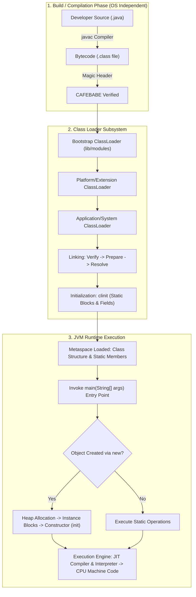
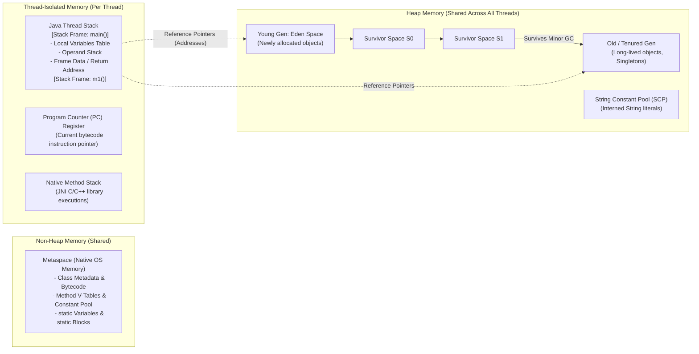

# ☕ Java Backend Engineering: The Complete Interactive Textbook & Architecture Blueprint

<div align="center">


<p align="center">
  <b>A comprehensive, production-grade, visually animated Java Backend engineering guide derived from deep recursive analysis of the <code>Java backend</code> workspace repository.</b>
</p>

</div>

---

## 📑 Complete Repository Analysis & Source Material Inventory

This interactive master document is **not a generic online Java tutorial**. It has been systematically synthesized by recursively auditing, extracting, correcting, and elaborating upon every single source file, code snippet, Eclipse workspace configuration, and technical note found in the `Java backend` Desktop repository.

### 🗂️ Discovered Directory & File Inventory

```
Java backend/
├── Day1/
│   └── Java Basics/
│       ├── CoreJavaNotes                                  # Foundational notes: Naming conventions, primitives, wrappers, OOP intro
│       └── src/
│           ├── coreJavaDemo/Demo.java                     # main() entry point, String[] args traversal, console output
│           ├── loopConditionalStatementsOperators/Demo.java # for, while, do-while, for-each, if-else, switch, ternary, operators
│           ├── methods/MethodDemo.java                    # Method declaration, invocation flow, call-stack return demonstration
│           └── variables/Vars.java                        # Primitive types, widening casting, narrowing truncation, char, String
├── Day2/
│   └── Advanced Java Concepts/
│       ├── CoreJavaNotes                                  # Detailed execution sequence (10 steps), OOP definitions, constructor rules
│       └── src/
│           ├── ClassFundamentals/
│           │   ├── Customer.class                         # Model class states (custId, custName, etc.) & behaviors (login, payment)
│           │   ├── ConstructorDemo.java                   # Constructor overloading, this() chaining, customer profile initialization
│           │   ├── Demo1.java                             # Static vs instance variables, static block, instance block, reference aliasing
│           │   └── Main.java                              # Execution orchestrator for ClassFundamentals
│           ├── coreJavaDemo/Demo.java                     # Extended command line args & JVM entry execution
│           ├── loopConditionalStatementsOperators/Demo.java # Comprehensive operator & loop patterns
│           ├── methods/MethodDemo.java                    # Stack-frame return value propagation
│           └── variables/Vars.java                        # Primitive overflow, char/int Unicode mapping
└── Day3/
    └── Oops part-1/
        ├── CoreJavaNotes                                  # In-depth OOP: 4 pillars, Object class 9 methods, overriding rules, access modifiers
        └── coreJavaDemo/
            └── src/
                ├── ClassFundamentals/ (ConstructorDemo, Demo1, Main)
                ├── encapsulation/Demo1.java               # POJO/JavaBean Employee class, private fields, public getters/setters
                ├── inheritence/
                │   ├── InheritanceDemo1.java              # Object class root ancestry, 9 methods (toString, hashCode, equals), super/sub
                │   └── Demo2.java                         # Multi-level inheritance (X -> Y -> Z), constructor chaining with super()
                ├── polymorphism/
                │   ├── Overloading.java                   # Compile-time polymorphism, method overloading, type promotion (int -> long)
                │   └── Demo1.java                         # Runtime polymorphism, method overriding, Covariant return types, method hiding nuances
                ├── loopConditionalStatementsOperators/Demo.java
                ├── methods/MethodDemo.java
                └── variables/Vars.java
```

### 🔍 Critical Technical Insights & Workspace Resolutions

During our recursive inspection of the raw learning materials, several vital architectural points and ambiguities were identified and clarified in this master textbook:

1. **The 10-Step Execution Sequence**: The notes in `Day2` and `Day3` outline a 10-step sequence from `.java` compilation down to non-static element readiness. We have formalized this into an architectural SVG workflow and detailed walkthrough explaining class loading, linking, `<clinit>` static block initialization, `main()` frame allocation, and `<init>` object instantiation.
2. **Object Class 9 Methods**: `Day3` notes list the methods inherited by every Java class from `java.lang.Object` (`hashCode()`, `equals()`, `toString()`, `clone()`, `wait()` 3 overloads, `notify()`, `notifyAll()`, `getClass()`, and `finalize()`). We provide full implementations of the `equals()` and `hashCode()` contract essential for backend hashing, caching, and Collections.
3. **Method Overriding vs. Method Hiding**: In `Day3/.../polymorphism/Demo1.java`, a comment noted `// this is called as method hiding its not overriding it looks like overriding` alongside a non-static method returning a covariant type. We provide the technically rigorous clarification: non-static methods with identical signatures are **dynamically dispatched at runtime (Overriding)**, whereas `static` methods declared with matching signatures in a child class represent **compile-time Method Hiding** because static members belong to the Class metadata, not object instances!
4. **Completion of Abstraction**: In `Day3` notes, the 4th pillar "4. Abstraction" was outlined as a heading but left empty. In this textbook, Abstraction is fully developed, demonstrating `abstract` classes, `interface` contracts, loose coupling, and its direct connection to Dependency Injection in Spring Boot.

---

## 🗺️ Interactive Table of Contents

- [1. IT Standard Naming Conventions & Clean Code](#1-it-standard-naming-conventions--clean-code)
- [2. Java Execution Pipeline & The 10-Step Lifecycle](#2-java-execution-pipeline--the-10-step-lifecycle)
- [3. JVM Runtime Memory Architecture (Metaspace, Heap & Stack)](#3-jvm-runtime-memory-architecture-metaspace-heap--stack)
- [4. Variables, Data Types & Type Casting](#4-variables-data-types--type-casting)
- [5. Operators & Expression Evaluation](#5-operators--expression-evaluation)
- [6. Control Flow, Loops & Branching Logic](#6-control-flow-loops--branching-logic)
- [7. Methods, Parameters & Call Stack Execution](#7-methods-parameters--call-stack-execution)
- [8. Class Fundamentals & Object Architecture](#8-class-fundamentals--object-architecture)
- [9. Constructors, Object Initialization & `this` Chaining](#9-constructors-object-initialization--this-chaining)
- [10. The 4 Pillars of OOP: Pillar 1 - Inheritance & Root `Object` Class](#10-the-4-pillars-of-oop-pillar-1---inheritance--root-object-class)
- [11. The 4 Pillars of OOP: Pillar 2 - Encapsulation & POJO / JavaBean Architecture](#11-the-4-pillars-of-oop-pillar-2---encapsulation--pojo--javabean-architecture)
- [12. The 4 Pillars of OOP: Pillar 3 - Polymorphism (Overloading vs Overriding vs Hiding)](#12-the-4-pillars-of-oop-pillar-3---polymorphism-overloading-vs-overriding-vs-hiding)
- [13. The 4 Pillars of OOP: Pillar 4 - Abstraction & Interface Contracts](#13-the-4-pillars-of-oop-pillar-4---abstraction--interface-contracts)
- [14. Access Modifiers & Package Security Matrix](#14-access-modifiers--package-security-matrix)
- [15. Connecting the Dots: From Core Java to Spring Boot Architecture](#15-connecting-the-dots-from-core-java-to-spring-boot-architecture)
- [16. Interactive Quizzes, Code Brain Teasers & Debugging Challenges](#16-interactive-quizzes-code-brain-teasers--debugging-challenges)
- [17. Structured 4-Stage Learning Roadmap & Progress Checklist](#17-structured-4-stage-learning-roadmap--progress-checklist)
- [18. Top 25 Backend Engineering Interview Questions & Master Cheat-Sheet](#18-top-25-backend-engineering-interview-questions--master-cheat-sheet)

---

## 1. IT Standard Naming Conventions & Clean Code

### 1.1 Technical Breakdown

| Entity Type | Convention | Format Pattern | Industry Production Example | Antipattern (Avoid) |
| :--- | :--- | :--- | :--- | :--- |
| **Packages** | `camelCase` / Reverse Domain | lowercase, dot-separated | `com.enterprise.banking.service` | `com.Enterprise.Banking_Service` |
| **Classes** | `PascalCase` | UpperCamelCase noun | `CustomerTransactionProcessor` | `customertransaction`, `customer_data` |
| **Interfaces** | `PascalCase` | Adjective or capability | `PaymentGateway`, `Auditable` | `payment_interface`, `IPaymentGateway` |
| **Enums** | `PascalCase` | UpperCamelCase | `OrderStatus`, `CurrencyCode` | `order_status_enum` |
| **Variables** | `camelCase` | lowerCamelCase noun | `accountBalance`, `userEmail` | `AccountBalance`, `user_email` |
| **Constants** | `ALL_CAPS` | Screaming snake_case | `MAX_RETRY_ATTEMPTS`, `DEFAULT_TIMEOUT` | `maxRetry`, `DefaultTimeout` |
| **Methods** | `camelCase` | lowerCamelCase verb phrase | `calculateInterest()`, `processRefund()` | `CalculateInterest()`, `calc_int()` |

### 1.2 Dual-Language Explanation

- **English**: In professional software engineering, naming conventions are non-negotiable coding standards enforced by static analysis tools (SonarQube, Checkstyle). Standardized names ensure that any backend engineer can instantly distinguish between a class type, an instance field, a constant, or an executable method without reading its declaration.
- **Hinglish**: Real-world software development me naming conventions koi optional cheez nahi hoti, balki yeh code readability aur maintainability ka sabse bada pillar hai. Agar aap code me dekhte ho `CustomerTransactionProcessor`, to bina definition dekhe aapko turant samajh aa jata hai ki yeh ek Class hai kyunki yeh `PascalCase` me hai. Agar aap dekhte ho `calculateInterest()`, to parenthesis aur `camelCase` dekhkar pata chal jata hai ki yeh ek method hai jo koi operation perform karta hai. Aur agar `MAX_RETRY_LIMIT` dekhte ho to pata chal jata hai ki yeh ek constant (`static final`) value hai jo change nahi hogi.

### 1.3 Real-Life Analogy: The International Postal & Shipping Protocol

1. **What happens in real life?** When sending an international parcel via DHL or FedEx, standard address formats must be adhered to: Country Code (uppercase, e.g., `IND`), City/State (title case, e.g., `Mumbai`), Street Address (detailed alphanumeric), and Postal Code. If an individual swaps the postal code into the recipient name field, automated sorting machines fail, leading to misdelivery.
2. **Which technical component does it represent?** Standardized postal fields represent Java naming conventions (`com.company.module` for packages, `PascalCase` for classes, `camelCase` for methods/variables, `UPPER_SNAKE_CASE` for constants).
3. **How does the analogy map to the actual implementation?** The Java compiler, IDE auto-completion engines, reflection frameworks (like Spring Boot), and team members act like the automated postal sorting system. When packages follow reverse-domain notation, no namespace collisions occur across millions of libraries in Maven Central.
4. **Where does the analogy stop being accurate?** A physical mail carrier might manually decipher a poorly formatted handwritten letter and eventually deliver it. In Java, while the compiler will technically compile a class named `customer_details`, reflection frameworks and naming conventions inside Spring (e.g., getter/setter property naming for JSON deserialization) will actively break at runtime.

### 1.4 Production Code Example

```java
package com.fintech.banking.model;

/**
 * Demonstrates standard industry naming conventions in a banking domain model.
 */
public class BankAccount {

    // 1. CONSTANTS: static final, UPPER_SNAKE_CASE
    public static final String DEFAULT_CURRENCY = "INR";
    public static final double MINIMUM_RESERVE_BALANCE = 1000.00;
    public static final int MAX_DAILY_TRANSACTION_COUNT = 50;

    // 2. INSTANCE VARIABLES: camelCase, private for encapsulation
    private final String accountNumber;
    private String accountHolderName;
    private double currentBalance;
    private boolean isAccountLocked;

    // 3. CONSTRUCTOR: PascalCase (matches class name exactly)
    public BankAccount(String accountNumber, String accountHolderName, double initialDeposit) {
        this.accountNumber = accountNumber;
        this.accountHolderName = accountHolderName;
        this.currentBalance = initialDeposit;
        this.isAccountLocked = false;
    }

    // 4. METHODS: camelCase, verb-driven names
    public boolean executeWithdrawal(double amount) {
        if (isAccountLocked) {
            System.out.println("[REJECTED] Account is locked due to security policy.");
            return false;
        }

        if ((currentBalance - amount) < MINIMUM_RESERVE_BALANCE) {
            System.out.println("[REJECTED] Cannot breach minimum reserve threshold: " 
                    + DEFAULT_CURRENCY + " " + MINIMUM_RESERVE_BALANCE);
            return false;
        }

        currentBalance -= amount;
        System.out.println("[SUCCESS] Withdrew: " + DEFAULT_CURRENCY + " " + amount 
                + " | Current Balance: " + DEFAULT_CURRENCY + " " + currentBalance);
        return true;
    }

    public double getCurrentBalance() {
        return this.currentBalance;
    }

    public static void main(String[] args) {
        BankAccount account = new BankAccount("ACC-IN-49210", "Aarav Patel", 15000.0);
        account.executeWithdrawal(3000.0);
        account.executeWithdrawal(12000.0); // Breaches minimum balance
    }
}
```

**Line-by-Line Walkthrough:**
- `package com.fintech.banking.model;`: Adheres to reverse-domain naming, preventing namespace conflicts across enterprise microservices.
- `public static final String DEFAULT_CURRENCY`: Screaming snake_case immediately tells any reader this is an immutable global constant stored in Metaspace.
- `executeWithdrawal(double amount)`: Verb-noun naming structure clearly conveys intent and operation upon invocation.

**Expected Console Output:**
```
[SUCCESS] Withdrew: INR 3000.0 | Current Balance: INR 12000.0
[REJECTED] Cannot breach minimum reserve threshold: INR 1000.0
```

---

## 2. Java Execution Pipeline & The 10-Step Lifecycle

### 2.1 The Architectural Workflow



### 2.2 The Precise 10 Steps of Java Execution

As noted in the Day 2 & Day 3 workspace materials, every Java program follows a strict 10-stage lifecycle:

1. **Compilation**: `Developer writes Demo.java` $	o$ `javac compiles it into platform-neutral bytecode Demo.class`.
2. **Class Loading & Linking**: The JVM ClassLoader subsystem delegates loading (Bootstrap $	o$ Platform $	o$ Application). It validates bytecode safety (Verify), allocates static memory with defaults (Prepare), and resolves symbolic references into direct pointers (Resolve).
3. **Static Member Scanning**: The JVM scans all `static` fields and methods, reserving space inside **Metaspace** (native memory).
4. **Static Block Execution (`<clinit>`)**: Any `static { ... }` initialization blocks run once in order of textual appearance.
5. **Main Method Invocation**: The JVM invokes `public static void main(String[] args)`, pushing the `main()` stack frame onto the thread's call stack.
6. **Static Elements Ready**: Static utilities, constants, and database configurations can now be invoked directly without instantiating any class.
7. **Object Instantiation (`new`)**: The `new` keyword allocates physical memory in the **Heap** for all non-static fields, initializing them to JVM defaults (`0`, `null`, `false`).
8. **Instance Initialization Block Execution**: Non-static `{ ... }` blocks run immediately upon object memory allocation, before the constructor.
9. **Constructor Execution (`<init>`)**: The constructor executes its `super()` call, assigns `this.field` values, and executes initialization logic.
10. **Non-Static Elements Ready**: The reference pointer is returned to the stack variable; the object instance is fully operational.

### 2.3 Dual-Language Explanation

- **English**: Java achieves platform independence via its two-stage execution architecture. Source code is never compiled directly into native machine instructions (like C/C++). Instead, `javac` compiles code into platform-independent intermediate **Bytecode** (`.class` files). When running, the Java Virtual Machine (JVM) acts as an abstraction layer between the bytecode and the host operating system. The JVM dynamically interprets bytecode and compiles hot performance-critical paths into native machine instructions using the Just-In-Time (JIT) compiler.
- **Hinglish**: Java ka sabse bada superpower hai **"Write Once, Run Anywhere" (WORA)**. C++ me jab aap code compile karte ho, to seedhe wahi machine ka binary code banta hai (agar Windows pe compile kiya to Linux pe nahi chalega). Lekin Java me `javac` compiler kabhi bhi direct CPU machine code nahi banata; yeh banata hai **Bytecode** (`.class` file jisme magic header `0xCAFEBABE` hota hai). Phir har operating system ke paas apna specific JVM hota hai (Windows ka JVM, Linux ka JVM, Mac ka JVM). JVM is bytecode ko padhta hai, ClassLoader ke through memory me load karta hai, aur execution engine (Interpreter + JIT Compiler) use karke machine code me convert kar ke CPU pe execute karta hai.

### 2.4 Real-Life Analogy: Architectural Blueprint & Industrial Pre-Fabrication

1. **What happens in real life?** An architect in Tokyo designs an earthquake-resistant skyscraper on an international blueprint format (CAD file). The blueprint does not contain physical concrete; it contains exact mathematical specifications. Construction teams in Mumbai, London, and New York each take that identical blueprint, load it into local machinery adapted to local materials (sand, cement, steel), and erect the physical building.
2. **Which technical component does it represent?**
   - Java Source Code (`.java`) = Architect's hand-drawn conceptual design.
   - `javac` Compiler = CAD translation software producing standard blueprints.
   - Bytecode (`.class`) = The standard, universal architectural CAD blueprint.
   - JVM = The local civil engineering team and factory in Mumbai or London.
   - CPU Machine Code = The physical steel and concrete skyscraper standing on real ground.
3. **How does the analogy map to the actual implementation?** You can send a single `.jar` or `.class` file across any cloud environment (AWS Linux, Azure Windows, Apple Silicon Mac). As long as a compatible JVM is installed on that server, the application runs identically without recompiling source code.
4. **Where does the analogy stop being accurate?** A physical construction project has material variations and structural defects due to local weather. In Java, JVM specifications (IEEE 754 floating point arithmetic, memory layout specifications, thread safety semantics) guarantee deterministic, uniform behavior across all certified JVM implementations.

### 2.5 Production Code Example: 10-Step Lifecycle Verification

```java
package com.backend.lifecycle;

/**
 * Verifies the 10-step Java execution lifecycle with runtime timestamps.
 */
public class ExecutionLifecycleDemo {

    // STEP 3: Static variable allocated in Metaspace during class loading
    public static String serverEnvironment = "METASPACE_UNINITIALIZED";
    public static int instanceCounter = 0;

    // STEP 4: Static initialization block (<clinit>) executes ONCE before main()
    static {
        serverEnvironment = "PRODUCTION-AP-SOUTH-1";
        System.out.println("[STEP 4: STATIC BLOCK] Executed once during class load. Environment set to: " 
                + serverEnvironment);
    }

    // Instance variables allocated in Heap upon 'new'
    private int connectionId;
    private String databaseUrl;

    // STEP 8: Instance initialization block runs on EVERY object creation before constructor
    {
        instanceCounter++;
        this.connectionId = 1000 + instanceCounter;
        System.out.println("  [STEP 8: INSTANCE BLOCK] Triggered for Heap instance #" 
                + instanceCounter + " | Assigned temp ID: " + this.connectionId);
    }

    // STEP 9: Constructor (<init>) executes
    public ExecutionLifecycleDemo(String databaseUrl) {
        this.databaseUrl = databaseUrl;
        System.out.println("  [STEP 9: CONSTRUCTOR] Constructor completed for DB: " + this.databaseUrl);
    }

    // STEP 10: Non-static method ready for business operations
    public void executeQuery(String sql) {
        System.out.println("    [STEP 10: BUSINESS EXECUTION] Conn #" + this.connectionId 
                + " executed SQL: " + sql);
    }

    // STEP 5: main() method entry point invoked by JVM
    public static void main(String[] args) {
        System.out.println("[STEP 5: MAIN ENTRY] main() method started on thread: " 
                + Thread.currentThread().getName());

        // STEP 6: Static members ready for use without instantiating any object
        System.out.println("[STEP 6: STATIC READY] Global Environment: " 
                + ExecutionLifecycleDemo.serverEnvironment);

        System.out.println("\n--- Instantiating Connection 1 ---");
        // STEP 7 -> 8 -> 9 -> 10
        ExecutionLifecycleDemo conn1 = new ExecutionLifecycleDemo("jdbc:postgresql://db1.internal:5432/orders");
        conn1.executeQuery("SELECT * FROM orders WHERE status = 'PENDING'");

        System.out.println("\n--- Instantiating Connection 2 ---");
        ExecutionLifecycleDemo conn2 = new ExecutionLifecycleDemo("jdbc:postgresql://db2.internal:5432/users");
        conn2.executeQuery("SELECT user_id, email FROM users WHERE active = true");
        
        System.out.println("\nTotal connections created: " + ExecutionLifecycleDemo.instanceCounter);
    }
}
```

**Expected Console Output:**
```
[STEP 4: STATIC BLOCK] Executed once during class load. Environment set to: PRODUCTION-AP-SOUTH-1
[STEP 5: MAIN ENTRY] main() method started on thread: main
[STEP 6: STATIC READY] Global Environment: PRODUCTION-AP-SOUTH-1

--- Instantiating Connection 1 ---
  [STEP 8: INSTANCE BLOCK] Triggered for Heap instance #1 | Assigned temp ID: 1001
  [STEP 9: CONSTRUCTOR] Constructor completed for DB: jdbc:postgresql://db1.internal:5432/orders
    [STEP 10: BUSINESS EXECUTION] Conn #1001 executed SQL: SELECT * FROM orders WHERE status = 'PENDING'

--- Instantiating Connection 2 ---
  [STEP 8: INSTANCE BLOCK] Triggered for Heap instance #2 | Assigned temp ID: 1002
  [STEP 9: CONSTRUCTOR] Constructor completed for DB: jdbc:postgresql://db2.internal:5432/users
    [STEP 10: BUSINESS EXECUTION] Conn #1002 executed SQL: SELECT user_id, email FROM users WHERE active = true

Total connections created: 2
```

---

## 3. JVM Runtime Memory Architecture (Metaspace, Heap & Stack)

### 3.1 JVM Memory Map



### 3.2 Deep Dive into Memory Regions

| Memory Region | Allocation Location | Scope & Visibility | Contents Stored | Lifecycle / Reclamation |
| :--- | :--- | :--- | :--- | :--- |
| **Java Thread Stack** | OS Thread RAM | Thread-Private (Isolated) | Method Stack Frames, Primitive local variables, Reference variables (pointers) | Automatically popped and freed upon method completion (`return`). Zero GC overhead! |
| **Heap Memory** | Virtual Process Space | Shared across all threads | All Objects, Class Instances, Arrays, Instance Variables, String Constant Pool | Reclaimed by the **Garbage Collector (GC)** when unreachable from GC Roots. |
| **Metaspace** (Java 8+) | Native OS Memory (Off-Heap) | Shared across all threads | Class definitions, method bytecode, static variables, annotations, reflection metadata | Reclaimed only when the owning `ClassLoader` is garbage collected (rare). |
| **PC Register** | Per-thread CPU register | Thread-Private | Address of the current bytecode instruction being executed | Exists for the lifetime of the thread. |
| **Native Method Stack**| Native RAM | Thread-Private | C/C++ execution frames invoked via Java Native Interface (JNI) | Destroyed when native function returns. |

### 3.3 Stack Frames & Reference Pointer Mechanics

When a Java thread invokes a method:
1. A **Stack Frame** is pushed onto that thread's call stack.
2. The stack frame allocates exact slots for primitive local variables (`int`, `double`, `boolean`) and reference handles (e.g., `Customer c1`).
3. If an object is instantiated (`new Customer(...)`), the physical object instance is constructed in **Heap Memory**.
4. The variable in the stack frame (`c1`) does **not** hold the object itself; it holds a 64-bit (or 32-bit compressed OOP) **memory reference pointer** directing the CPU to that Heap address!
5. **Reference Aliasing (`c2 = c1`)**: Assigning `Customer c2 = c1` does **not** create a new object. It merely copies the memory address from `c1`'s stack slot into `c2`'s stack slot. Both reference pointers now point to the exact same physical heap memory! Any modification via `c2.setName(...)` instantly mutates what `c1.getName()` observes.

### 3.4 Dual-Language Explanation

- **English**: Understanding the partition between Stack, Heap, and Metaspace is the single most critical foundation for backend engineering. In high-concurrency microservices processing 10,000 requests per second, local primitives live and die instantly inside their thread's stack frames without triggering garbage collection. Conversely, long-lived domain objects live on the Heap and are managed by background GC threads. If you unintentionally leak references in static collections (which live in Metaspace/Old Gen), the JVM will eventually crash with `java.lang.OutOfMemoryError: Java heap space`.
- **Hinglish**: JVM memory architecture samajhna har backend engineer ke liye sabse important skill hai. Yaad rakhne ka simple formula:
  - **Stack** = Har thread ka private kamra. Jab bhi koi method call hota hai (jaise `main()` ya `m1()`), stack me ek naya **Stack Frame** banta hai. Isme local variables aur memory reference pointers rehte hain. Jaise hi method khatam hua, stack frame turant destroy ho jata hai—iski safaai ke liye Garbage Collector ki zaroorat nahi padti!
  - **Heap** = Pure program ka common godown (warehouse). Jitne bhi objects aap `new` keyword se banate ho, wo sab Heap me bante hain. Har thread in objects ko access kar sakta hai agar uske paas unka reference pointer ho. Inki safaai **Garbage Collector** karta hai jab koi stack variable unhe point nahi kar raha hota.
  - **Metaspace** = Company ka master documentation archive. Isme class ki structure, method ka bytecode, aur `static` variables rehte hain. Yeh native operating system memory me hota hai aur pure application me sirf ek baar load hota hai.

### 3.5 Real-Life Analogy: The Corporate Bank Vault, Work Desks & Central Filing Room

1. **What happens in real life?** Inside a major retail bank branch:
   - **Central Archive Room (Metaspace)**: Contains the legal banking bylaws, account type blueprints, and global interest rate boards (`static` values). There is only one central rulebook for the entire bank.
   - **Main Banking Vault (Heap)**: The shared, massive warehouse where all individual safety deposit boxes (actual Customer Objects) physically reside.
   - **Tellers' Private Desks (Stack)**: Each teller has their own desk. On the desk, the teller keeps a notepad (Stack Frame). The notepad does not hold the physical safety deposit box; it only holds a **token ticket number with the vault locker address** (`0x7A1F`).
   - If Teller A passes the locker number to Teller B on a slip of paper (`tellerB = tellerA`), both tellers are now operating on the exact same physical locker in the vault!
2. **Which technical component does it represent?**
   - Central Archive = Metaspace.
   - Safety Deposit Boxes in Vault = Objects in Heap.
   - Teller's Desk Notepad = Stack Frame with local variables and pointer addresses.
   - The night janitorial crew recycling abandoned boxes = Garbage Collector.
3. **How does the analogy map to the actual implementation?** When a customer leaves the counter (method returns), the teller's notepad is wiped clean (stack frame popped). But the box remains in the vault (Heap). If the customer closes their account and no one holds the locker key (unreachable from GC Roots), the bank janitor clears out the locker to make room for new customers.
4. **Where does the analogy stop being accurate?** Physical safety deposit boxes take up physical space forever until human legal action occurs. In the JVM, memory reclamation is completely automated through generational algorithms (Minor GC, Major GC, ZGC, G1GC) that pause threads (Stop-The-World events) if heap pressure spikes.

### 3.6 Production Code Example: Memory Allocation & Reference Aliasing

```java
package com.backend.memory;

/**
 * Demonstrates Stack vs Heap memory allocation, pointer aliasing,
 * and static variable sharing across independent threads.
 */
public class MemoryArchitectureDemo {

    // METASPACE: Shared across all instances and threads
    public static int globalActiveSessions = 0;

    // HEAP: Allocated separately per object instance
    private final int sessionId;
    private String clientUsername;
    private boolean isAuthenticated;

    public MemoryArchitectureDemo(int sessionId, String clientUsername) {
        this.sessionId = sessionId;
        this.clientUsername = clientUsername;
        this.isAuthenticated = false;
        globalActiveSessions++; // Updates Metaspace shared state
    }

    public void authenticate(String passwordHash) {
        // STACK: Local variable allocated strictly within this method's stack frame
        long verificationStartTime = System.currentTimeMillis();
        
        if (passwordHash != null && !passwordHash.isEmpty()) {
            this.isAuthenticated = true;
        }

        System.out.println("[STACK FRAME: authenticate()] Session " + sessionId 
                + " authenticated in " + (System.currentTimeMillis() - verificationStartTime) + " ms");
        // Stack frame popped automatically here upon method return!
    }

    public void setClientUsername(String newName) {
        this.clientUsername = newName;
    }

    public String getClientUsername() {
        return this.clientUsername;
    }

    public boolean isAuthenticated() {
        return this.isAuthenticated;
    }

    public static void main(String[] args) {
        System.out.println("=== JVM Memory Architecture Demonstration ===");
        System.out.println("Initial Active Sessions (Metaspace): " + MemoryArchitectureDemo.globalActiveSessions);

        // 1. Stack creates variable 'user1'; Heap creates object @ address 0x1A2B
        MemoryArchitectureDemo user1 = new MemoryArchitectureDemo(101, "Siddharth Verma");

        // 2. Stack creates variable 'user2'; Heap creates distinct object @ address 0x3C4D
        MemoryArchitectureDemo user2 = new MemoryArchitectureDemo(102, "Ananya Sen");

        System.out.println("Active Sessions after 2 logins: " + MemoryArchitectureDemo.globalActiveSessions);

        // 3. Demonstrating Reference Aliasing:
        // 'user3' is allocated on the Stack, but it copies the pointer address of 'user1'!
        MemoryArchitectureDemo user3 = user1;

        System.out.println("\n--- Verifying Reference Pointer Aliasing ---");
        System.out.println("user1 address == user3 address: " + (user1 == user3) + " (Identical Heap pointer!)");
        System.out.println("user1 address == user2 address: " + (user1 == user2) + " (Distinct Heap objects!)");

        // Mutating user3 directly mutates the object user1 points to:
        System.out.println("Mutating username via user3 to 'Siddharth V. (Updated)'...");
        user3.setClientUsername("Siddharth V. (Updated)");

        System.out.println("Checking user1 username: " + user1.getClientUsername() + " (Reflected!)");
        System.out.println("Checking user2 username: " + user2.getClientUsername() + " (Unchanged!)");

        // Invoking method pushes and pops stack frame
        user1.authenticate("hash_sha256_998124");
    }
}
```

**Expected Console Output:**
```
=== JVM Memory Architecture Demonstration ===
Initial Active Sessions (Metaspace): 0
Active Sessions after 2 logins: 2

--- Verifying Reference Pointer Aliasing ---
user1 address == user3 address: true (Identical Heap pointer!)
user1 address == user2 address: false (Distinct Heap objects!)
Mutating username via user3 to 'Siddharth V. (Updated)'...
Checking user1 username: Siddharth V. (Updated) (Reflected!)
Checking user2 username: Ananya Sen (Unchanged!)
[STACK FRAME: authenticate()] Session 101 authenticated in 0 ms
```

---
